# 5. Comparison with the paper

Three sources are compared: the numbers printed in the paper (Gaborieau et al., *Nature Microbiology* 2024, and its preprint) together with the publisher's Supplementary Information, Supplementary Tables 1–7 and Source Data files; the authors' shipped results in their repository; and this replication, run once on the shipped inputs and once on inputs regenerated from the genomes. Every paper number carries its place in the article in the `paper_source` column of [`results/comparison/paper_vs_replication.csv`](../results/comparison/paper_vs_replication.csv).

The publisher's files (13 files, 8.7 MB) are downloaded by `scripts/download_supplement.sh` and are not redistributed here. `scripts/compare_source_data.py` compares them with this replication.

## What the supplement settled

| Open question | Answer from the supplement |
|---|---|
| Why 402 strains here and 403 in the paper? | The public matrix lacks strain LF110; Supplementary Table 3 has it. The other 402 strains are identical in both files |
| New phage names in the paper (PDP21_P1, CLB_P2, …) | Matched one to one with the public names by identical interaction vectors (`results/comparison/phage_name_map.csv`). The earlier guess of the mapping was right, and PDP110_P1 = 411_P1 is confirmed |
| ANOVA F of Fig 2f (113.9 here, 114.7 in the paper) | With all 403 strains F = 114.66, as in the paper and in its Source Data |
| The 85 % average AUROC of Fig 5a | Fig 5a plots one AUROC per **strain** (Source Data). The paper's own Source Data averages 0.872 (median 0.892) and this run gives 0.881 (0.895) on the same 315 strains; the text's 85 % is below the mean of its own data. The preprint's 77 % is the per-phage mean (0.787 here) |
| Genus PERMANOVA R² (0.27 here, 0.13 in the paper) | The 0.13 matches the increase of the adjusted R² when genus is added after isolation strain (0.686 − 0.554 = 0.13). That is our reading; the paper does not say so |
| BRIM modularity (ED2) | Supplementary Text 5 gives Q = 0.23 (P < 1e-3) and a BINMATNEST temperature T = 11.63; this run gives Q = 0.233 with four modules. T has no counterpart here (NODF was computed) |
| Fig 4a counts (28 adsorption-factor terms here, 52 in the paper) | The paper's Source Data counts terms up to pMCMC 0.0089, i.e. a threshold of 0.01, not the 1e-3 of the Methods. At 0.01 this re-run gives 51 adsorption-factor terms and 3 defense terms (paper 52 and 1; its single defense term is the outer-membrane variant YNCDOther, which its Source Data files under defense systems). Signs of the shared terms agree (31 of 31); only 19 of the 53 (phage, term) pairs are significant in both, because terms close to the threshold change from run to run |
| ED6 B and D (AMR genes) | The AMR counts per strain are in the Source Data (not in the public repository). With them: genome size against average MLC pMCMC 0.003 (significant), AMR against average MLC 0.0105 and against lytic interactions 0.047 (not significant at 0.01), genome size against lytic interactions 0.12 |
| ED7, the definition of "productive lysis" | Not settled; see below |
| Recommender code | Not in the supplement; see below |

## Headline numbers

| Item | Paper | Authors' shipped | This run (shipped inputs) | This run (regenerated inputs) |
|---|---|---|---|---|
| Mean AUROC per strain (Fig 5a) | 0.85 text; 0.872 Source Data | 0.881 | 0.881 (0.878 over all 390 strains with both classes) | 0.877 |
| Mean AUROC per phage (preprint) | 0.77 | 0.781 | 0.787 | 0.765 (0.769 with our matrix) |
| Pooled AUROC (Fig 5b) | 0.86 text; 0.849 from the curve points | 0.857 | 0.856 | 0.855 (0.853) |
| Average precision, F1 | 0.60, 0.60 | 0.601, 0.596 | 0.598, 0.599 | 0.596, 0.592 |
| Cocktail success tailored / generic / baseline (Fig 6d) | 91.67 / 78.95 / 81 % | same data | 91.67 / 78.95 / 81 % | not applicable |
| Mann–Whitney (Fig 6e) | U 399.5, P 0.019; U 1171.5, P 0.034 | same data | identical | not applicable |
| Defense count vs lytic interactions, β (Fig 4c) | −0.22 (CI −0.74 to 0.34) | – | −0.233 | −0.235 |
| Defense count vs average MLC, β (Fig 4d) | −0.04 (CI −0.05 to −0.01) | – | −0.033 | −0.037 |
| ANOVA, host range by morphotype (Fig 2f) | F = 114.7 | – | F = 114.7 | F = 118.7 (369 strains) |
| PERMANOVA adj. R², genus added after isolation strain / isolation strain / both | 0.13 / 0.53 / 0.65 | – | 0.13 / 0.55 / 0.69 | 0.14 / 0.53 / 0.67 (369 strains) |
| BRIM modularity Q (ED2) | 0.23 | – | 0.233 | 0.242 (369 strains) |
| PDP110_P1 infected strains, all K55 (ED5) | 3, all K55 | – | 3, all K55 | 2, both K55 (369 strains) |

The table has 97 rows in all: 33 match within 5 %, 12 match, 1 matches once explained (the 403rd strain), 4 are consistent with the paper's confidence interval or item list, 23 differ, and 24 cannot be compared numerically (the paper gives no number, or the panel is qualitative). Rows 74 to 97 come from the supplementary analyses and the genome maps of [10](10_repository_analyses.md). The chart shows each comparable number as our value divided by the paper's.

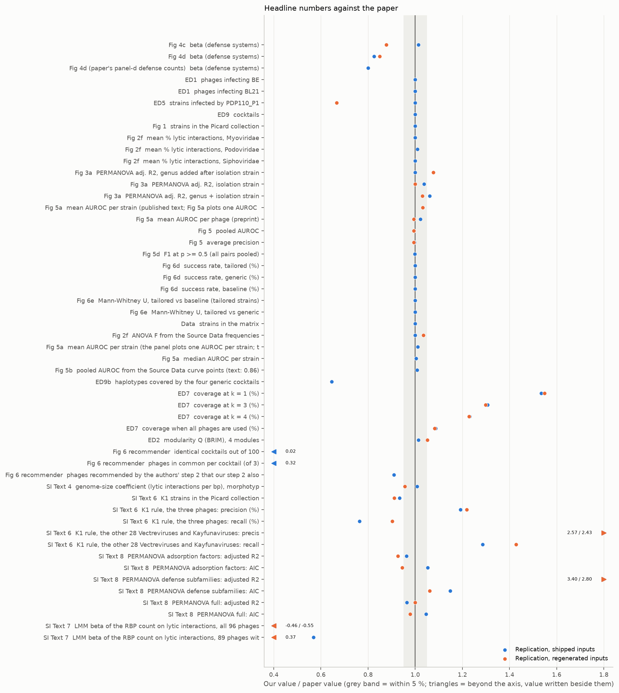

*Annotation.* One row per paper number with a single numeric value on both sides; x = our value divided by the paper's (black line = 1, grey band = within 5 %); blue = shipped inputs, orange = regenerated inputs; triangles at the edge mark ratios beyond the axis, with the value beside them. Full annotation in [06](06_figures.md).

Data: `results/comparison/cmp_headline.csv`.

## Matrix-only analyses on the regenerated matrix

The matrix regenerated from the raw plaque scores covers 369 strains: the 33 phage isolation strains were assayed separately and are not in the raw table, and 21 cells could not be interpreted. Fig 2f, Fig 3a, ED2 and ED5 need only the matrix, so they were redone on it (`scripts/regen_matrix_analyses.py`). Each analysis is shown three ways so that the effect of the missing strains can be told from the effect of regenerating the matrix:

| Analysis | Paper | Authoritative matrix, 403 strains | Same 369 strains | Regenerated matrix, 369 strains |
|---|---|---|---|---|
| ANOVA F, host range by morphotype | 114.7 | 114.7 | 119.3 | 118.7 |
| PERMANOVA adj. R², genus added after isolation strain | 0.13 | 0.13 | 0.13 | 0.14 |
| PERMANOVA adj. R², isolation strain | 0.53 | 0.55 | 0.53 | 0.53 |
| PERMANOVA adj. R², both | 0.65 | 0.69 | 0.67 | 0.67 |
| NODF (nestedness; the paper's BINMATNEST T = 11.63 is not comparable) | – | 52.1 | 53.3 | 53.2 |
| BRIM modularity Q (modules) | 0.23 | 0.233 (4) | 0.240 (7) | 0.242 (8) |
| Strains infected by PDP110_P1 (all K55) | 3 | 3 | 2 | 2 |

What the table shows. Regenerating the matrix changes almost nothing (the last two columns agree to about 0.5 % for the ANOVA, 0.01 for the R² and 0.002 for Q); the differences from the paper come from the missing strains. Without the 33 isolation strains the host-range R² moves toward the paper's (0.55 to 0.53; both 0.69 to 0.67) and the ANOVA F moves away from it (114.7 to 119). The best number of BRIM modules is unstable (4, 7, 8) although Q is stable (0.23 to 0.24). ED5 loses one of its three infected strains because the third is the isolation strain PDP110 itself, which is not in the 369; regenerated Kaptive types call K55 for the other two but miss K55 in PDP110, as in [03](03_feature_regeneration.md). Data: `results/comparison/regenerated_matrix_analyses.csv`.

## Mixed models, ED6, ED7 and the supplementary analyses on regenerated inputs

Everything that can be rebuilt was rerun with the regenerated inputs: the matrix from the raw plaque scores (369 strains, no isolation strains), the features, tree and defense subtypes regenerated from the genomes. Fixed items stay as they are: the phage genomes, `RBP_list.csv` (no RBP detection was rerun), the paper's AMR counts and the paper's defense counts of panel d. The 38 rows of the comparison table that have a regenerated value are marked in `results/comparison/paper_vs_replication.csv`.

| Item | Paper | Shipped inputs | Regenerated inputs |
|---|---|---|---|
| Fig 4c, defense count vs lytic interactions, β (pMCMC) | −0.22 (0.41) | −0.223 (0.40) | −0.193 (0.51), 369 strains |
| Fig 4d, defense count vs average MLC, β (pMCMC) | −0.04 (0.004) | −0.033 (0.0005) | −0.034 (0.0003), 357 strains |
| Fig 4d with the paper's panel-d defense counts | −0.04 (0.004) | −0.032 (0.0005) | −0.028 (0.0021) |
| ED6 C, genome size vs average MLC, β per Mb (pMCMC) | significant | −0.35 (0.003) | −0.24 (0.014) |
| ED6 D, AMR genes vs average MLC (pMCMC) | not significant | −0.021 (0.0105) | −0.018 (0.020) |
| ED6 A and B (lytic interactions) | – | genome size 0.12; AMR 0.047 | genome size 0.55; AMR 0.063 |
| ED7 coverage at k = 1 / 3 / 4 (%) | 42.7 / 67.0 / 73.7 (Source Data) | 65.5 / 87.6 / 90.8 | 66.1 / 87.0 / 90.5 |
| SI 4, genome-size coefficient (P) | 2.3e-4 (0.17) | 2.32e-4 (0.17) | 2.2e-4 (0.16) |
| SI 6, K1 strains | 45 | 42 | 41 in the 369 strains (45 with the four K1 isolation strains) |
| SI 6, K1 rule on the three phages: precision / recall (%) | 73 / 72 | 87 / 55 | 89 / 65 |
| SI 6, K1 rule on the 28 other phages: precision / recall (%) | 7 / 14 | 18 / 18 | 17 / 20 |
| SI 7, RBP-count LMM β (pMCMC), 96 phages | 28.1 (0.33) | −13.0 (0.52) | −15.4 (0.41) |
| SI 8, PERMANOVA adjusted R² adsorption factors / full / defense | 0.27 / 0.28 / 0.05 | 0.26 / 0.27 / 0.17 | 0.25 / 0.28 / 0.14 |
| SI 8, AIC adsorption factors / full / defense | −435 / −418 / −372 | −458 / −437 / −427 | −411 / −409 / −395 |
| RBP sharing, host-range distance sharing / not (≥ 50 % identity) | qualitative | 0.56 / 0.85 | 0.56 / 0.85 |

Reading it.
- **Regeneration does not change the conclusions.** Defense systems stay non-significant for the number of lytic interactions and significant (small) for the average MLC; genome size stays associated with the average MLC and not with the number of lytic interactions; the K1 rule stays imprecise outside the three phages; the RBP count stays unrelated to host range; adsorption factors stay the best PERMANOVA model by a little (AIC −410.7 against −409.2 for the full model in the regenerated set).
- **The K1 count is reproduced by regeneration.** Our ABC calls give 45 K1 strains in the whole collection, the paper's number, where the shipped table has 42 (three strains the shipped table leaves without a serotype). The paper's 45 therefore probably comes from a later classification than the shipped table.
- **The genome-size association is weaker on the regenerated matrix** (0.014 against 0.003) and is significant again with the paper's own genome sizes (0.002), so it depends on the 33 isolation strains and on small differences between assemblies.
- **With the paper's panel-d defense counts the regenerated-matrix pMCMC (0.0021) is the closest to the paper's 0.004 of all runs.**
- The AIC values are on a different scale in the two columns because the number of strains differs (402 and 369).

Not run on regenerated inputs: Fig 4a–b (the per-phage mixed models take about 4.5 hours and would need regenerated defense subfamilies, which need the authors' gene clustering), and ED9 (the cocktail data belong to the 100 test strains, whose genomes are not available).

## Empty cells in the headline table, and why

| Where | Why it is empty |
|---|---|
| "Authors' shipped" column, "–" | The repository holds no result for these numbers (the β of Fig 4c–d, the ANOVA, the PERMANOVA, the modularity, ED5, the supplementary analyses); they were computed here from the authors' data |
| "Regenerated inputs" column, cocktail success and Mann–Whitney (Fig 6) | Cannot be run. They are in vitro results on 100 test strains, not model output; the recommender's code is not published and the test-strain genomes are not available |
| "Regenerated inputs" column, Fig 4a–b and ED9 | Not run: Fig 4a–b needs 4.5 hours of sampling and regenerated defense subfamilies; ED9 uses the test strains' cocktail data |
| "Regenerated inputs" column, everything else | Filled (see above and the matrix-only table), with the 33 isolation strains missing from the regenerated matrix |

## Pooled ROC and precision–recall curves

The three curves of the authors' shipped predictions, this run on the shipped inputs and this run on the regenerated inputs lie on top of each other (AUROC 0.857, 0.856, 0.855; average precision 0.601, 0.598, 0.596). The dashed black line is the curve exported in the paper's Source Data, which gives an AUROC of 0.849 from its points (the text says 0.86; the exported precision–recall block holds only the tail, recall 0.945 to 1, so it is not drawn).

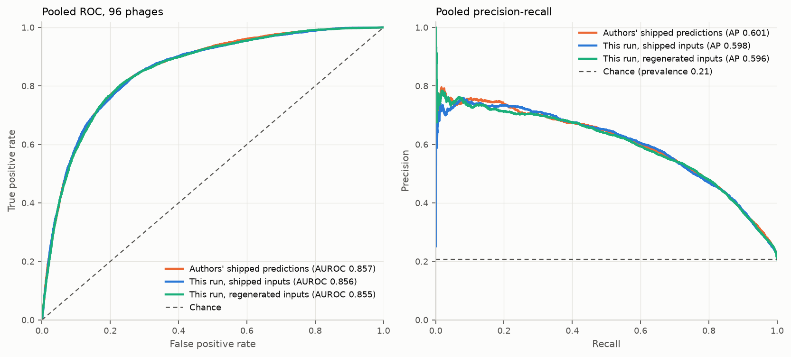

*Annotation.* Left ROC, right precision–recall, pooled over the 96 phages. Orange = authors' shipped predictions, blue = this run (shipped inputs), aqua = this run (regenerated inputs), black dashed = the paper's Source Data curve, grey dashed = chance. Overlapping curves mean the same pooled performance. Full annotation in [06](06_figures.md).

Data: `results/comparison/cmp_roc_pr.csv` (without the paper's points, which are the publisher's data). Per-phage AUROC against the authors' shipped values (correlation 0.92 on shipped inputs, 0.79 on regenerated ones):

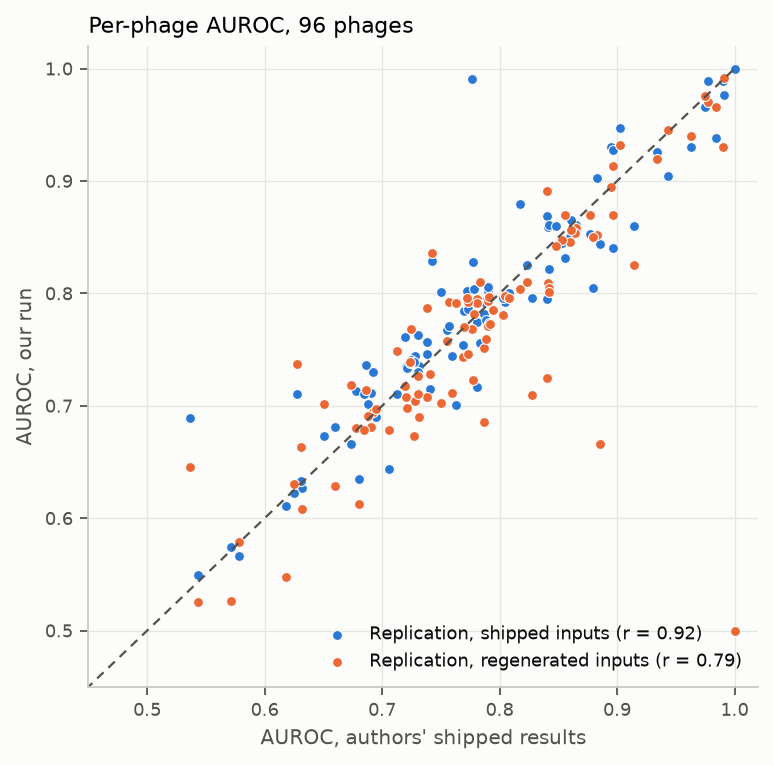

*Annotation.* One dot per phage: x = AUROC in the authors' results, y = AUROC here; dashed diagonal = identical. Blue = shipped inputs (r = 0.92), orange = regenerated inputs (r = 0.79).

Redrawn panels next to their paper numbers (per-strain AUROC with the paper's Source Data points in orange, cocktails, mixed models and defense count, host range by morphotype, host-range UMAP):

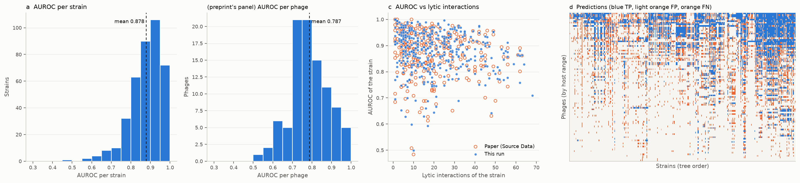

*Annotation.* a: histogram of the AUROC of each strain (mean 0.878, dashed). Second panel: AUROC of each phage (mean 0.787, the preprint's number). c: AUROC of each strain against its lytic interactions, blue = this run, orange circles = the paper's Source Data. d: prediction matrix, rows = phages by host range, columns = strains in tree order; blue = true positive, light orange = false positive, orange = false negative.

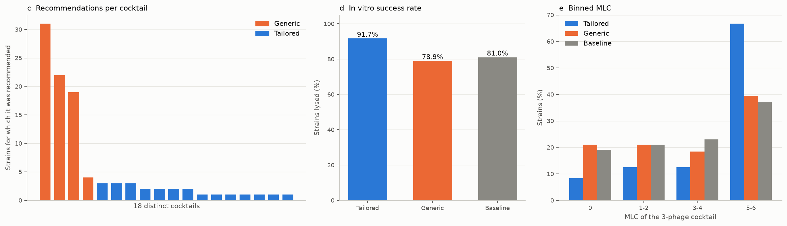

*Annotation.* c: strains per recommended cocktail (orange = generic, blue = tailored). d: success rate, tailored 91.7 %, generic 78.9 %, baseline 81.0 %. e: share of strains per MLC bin (0, 1–2, 3–4, 5–6) for tailored (blue), generic (orange) and baseline (grey).

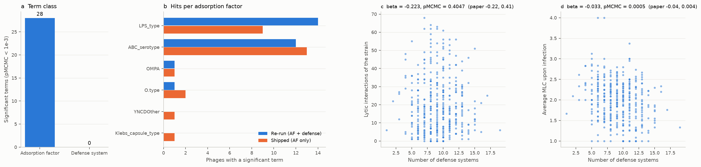

*Annotation.* a: significant terms at pMCMC < 1e-3 (blue adsorption factors 28, orange defense systems 0). b: phages with a significant term per adsorption-factor family, blue = this re-run, orange = authors' shipped model. c, d: strains by number of defense systems against lytic interactions (c) and average MLC (d); titles give the mixed-model β and pMCMC against the paper's.

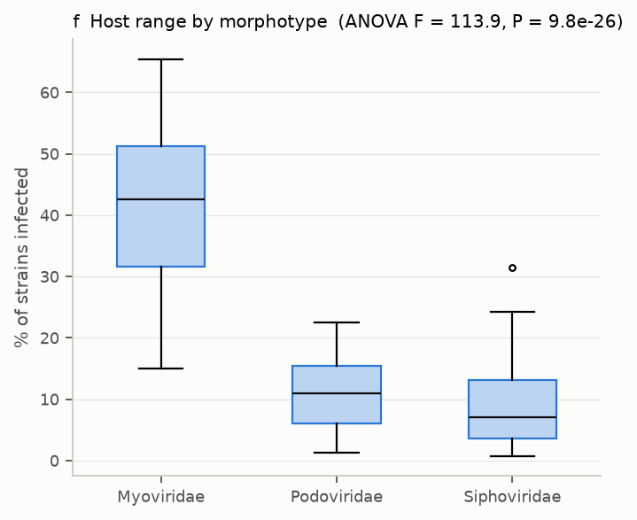

*Annotation.* Box plot of the percentage of strains each phage infects, by morphotype (32 myoviruses, 41 podoviruses, 23 siphoviruses); medians 42.5, 11.0 and 7.0 %; title gives the one-way ANOVA.

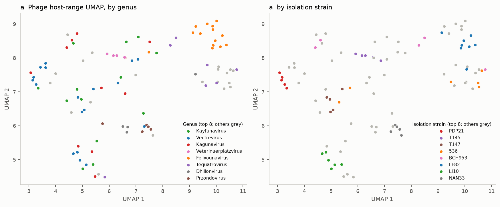

*Annotation.* UMAP of the Jaccard distance between the lytic vectors of the 96 phages, one dot per phage; left coloured by genus, right by isolation strain (top 8 coloured, others grey).

## What still does not match

| Item | Difference | What is known |
|---|---|---|
| ED7, coverage of the most-covering k-sets | Source Data: 42.7 % for one phage, 67.0 % for the triplet, 73.7 % for four, 89.3 % at the plateau; the text says 63 % and 68 % for three and four; this run gives 65.5, 87.6, 90.8 and 97.0 % with lysis at any concentration | The paper contradicts itself (text 63 % against Source Data 67 %). No set of MLC scores reproduces the Source Data (best single phage 172 of 403 strains there; any MLC > 0: 264; MLC 2–4: 175; plateau 360 strains against 391 with any lysis). The matrix used for ED7 may differ from the final one |
| ED9b, "haplotypes per cocktail" | Source Data 31, 21, 19, 4; this run 20, 18, 18, 4 | The Source Data values equal the strain counts of Fig 6c, so they count strains, not haplotypes as the legend says |
| ED9a Mann–Whitney P | 4e-9 here, 3.5e-12 in the paper | The step shares are identical (tailored 76.4 %, generic 38.7 % at step 1); the test unit is not stated |
| Cocktail labels (Fig 6) | Supplementary Table 7 labels 28 strains as tailored and 72 as generic; the 24/76 split used here gives the paper's 91.67 % (22/24) and 78.95 % (60/76) | Table 7 marks the four-strain cocktail 536_P7-DIJ07_P2-LF82_P8 as tailored; the figure treats it as generic. The Source Data of Fig 6c lists 99 strains where the cocktail file has 100 |
| Fig 4d pMCMC | 0.0003 here, 0.004 in the paper | Both significant; the estimates agree |
| Combined PERMANOVA (0.69 vs 0.65) | 6 % | Own implementation; the adjusted-R² formula may differ |
| Fig 2f P value | 7.9e-26 here, 1.44e-26 printed | The Source Data frequencies give 7.9e-26 too, so the printed P is not the one-way ANOVA P of these data |
| Genome sizes (ED6) | Our assemblies are on average 69 kb smaller than the paper's (correlation 0.99) | Probably a different assembly version |
| ED2 nestedness | not comparable | NODF here, BINMATNEST temperature (11.63) in the paper |

## Cocktail recommender

The recommender's code is not published and is not in the supplement. The authors' repository describes it in its README (sections 2.3 to 2.6), which differs slightly from the Methods: step 1 compares O-type, ST, ABC, Klebsiella and LPS (the Methods say ST, O, H, LPS, ABC), and step 2 keeps phages that infect at least half of the group (the Methods say more than half). It was re-implemented from the README (`scripts/recommender.py`, `SPEC=readme`; `SPEC=paper` follows the Methods and gives identical cocktails here): a random forest (depth 4, 80 trees, positive class weight 1.5) on the phage identity and five "same as the isolation strain" indicators; the strains of the Picard collection with the same ST, O and H and the phages that infect most of them; the same forest on all bacterial features; the most generalist phages; then the first three allowed phages with probability above 0.5, never two of the same genus and isolation host. The test strains' genomes are not shipped, so their ABC and Klebsiella types are unknown (Supplementary Table 6 gives ST, O, H, LPS and phylogroup only) and their UMAP coordinates were recomputed from the shipped distance matrix. One test strain (AN03) has the name of a Picard strain and has no UMAP coordinates.

The re-implementation does not reproduce the authors' cocktails: 2 of 100 are identical and on average 0.97 of the 3 phages are shared (75 cocktails share exactly one phage). The haplotype-neighbour step is reproduced (10 of the 11 phages the authors chose at step 2 are also recommended by our step 2), the two forest steps are not (the authors' forests give probabilities of 0.5 to 0.66; ours stay below 0.5 unless every feature is considered at every split, which was therefore adopted, and then only 8 % of phages come from step 3 against 26 %). The authors' step-4 phages are LF82_P8 and 55989_P2; ranking phages by lysis at plaque or clearing (MLC 3–4) puts them second and fourth, ranking by lysis at any concentration puts them seventh and sixth. Four variants (one-hot or integer phage identity, all or √n features per split) are in `results/recommender/variants.csv`; none gets close.

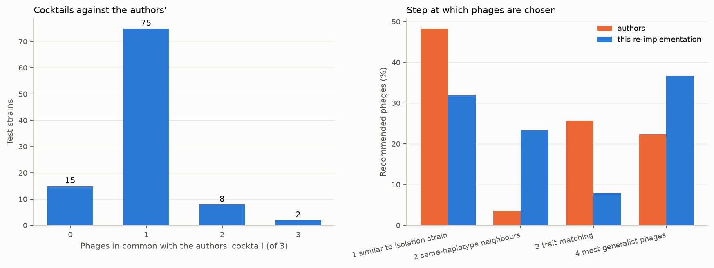

*Annotation.* Left: test strains by the number of phages (0–3) their cocktail shares with the authors'. Right: share of recommended phages chosen at each step; orange = authors, blue = this re-implementation.

Data: `results/comparison/cmp_recommender.csv`, `results/recommender/`.

## Regenerated inputs and necessity of features

How well each input was regenerated is in [03](03_feature_regeneration.md); the ablation on both input sets is in [04](04_feature_necessity.md). In short, the pooled AUROC survives regeneration, and the verdicts on the ABC capsule, LPS and the O-type/ST pair are the same on both input sets; three of twelve verdicts differ.

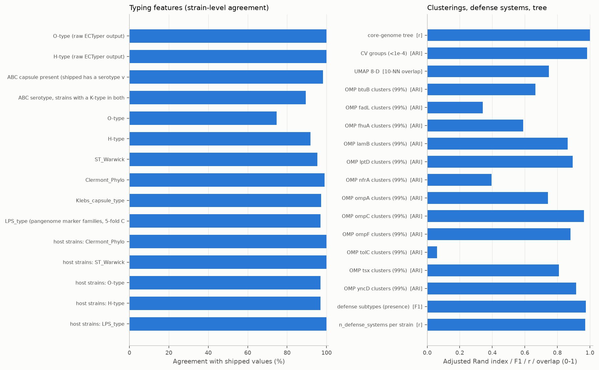

*Annotation.* Left: strain-level agreement (0–100 %) of each regenerated typing feature with the shipped table. Right: adjusted Rand index, F1, correlation or neighbour overlap (0–1) for the clusterings, defense subtypes and tree.

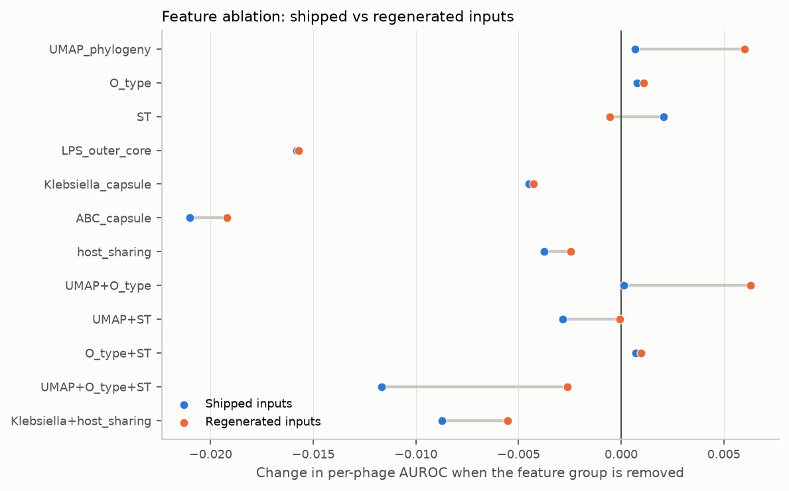

*Annotation.* Change in per-phage AUROC when a feature group is removed (negative = worse); blue = shipped inputs, orange = regenerated inputs, grey segment joins the same group.

## Not drawn, and why

Fig 1k (1,026 GenBank genomes and vConTACT2), Fig 6b (test-strain genomes are not shipped), ED1 MG1655 (not in the public matrix). Supplementary Tables 1–7 contain no accession list for the phage network and no genome identifiers for the test strains beyond Supplementary Table 6.

## Repository analyses and differences

The notebooks of the authors' repository, the supplementary analyses and the genome maps (Fig 3b, ED3) are in [10](10_repository_analyses.md); every difference between the repository and the paper that turned up is in [11](11_repository_vs_paper.md). Most of the 23 rows that still differ are differences inside the paper or between the repository and the paper (ED7, ED9b, the cocktail labels, the K1 counts, the RBP list), not failures of this replication.

## Configuration differences

28 differences between the paper's settings and what was run, each with a reason and an expected effect, are in [07](07_configuration.md) and `config/config_diff.csv`.

## Files compared and files still needed

| Origin | File | Status |
|---|---|---|
| Paper | preprint and published article (PDF and text) | used; not redistributed here |
| Publisher | Supplementary Information, Reporting Summary, Peer Review File | downloaded (`scripts/download_supplement.sh`) |
| Publisher | Supplementary Tables 1–7 (one workbook) | downloaded |
| Publisher | Source Data for Fig 1–6, ED6, ED7 and ED9 (nine workbooks) | downloaded; none for ED1, ED2, ED4 or ED5 |
| Authors' repository | interaction matrix (402 × 96), predictions, cocktail data, MCMC results | downloaded; also checked: 14 commits, none holds the cross-validation groups or the recommender |
| Zenodo 10.5281/zenodo.13831957 | archive of the same repository at publication (146.8 MB) | not downloaded; described as a copy of the GitHub repository |
| figshare | 403 bacterial assemblies | downloaded |
| Not available | cross-validation group file; recommender code; test-strain genomes; 1,026 GenBank phage genomes | would have to come from the authors |

List: `results/comparison/file_inventory.csv`.

## Limits

Single seed per model run; UMAP layouts differ run to run; the recommender is a best-effort re-implementation; the paper's ED7 curve could not be derived from the matrix.
