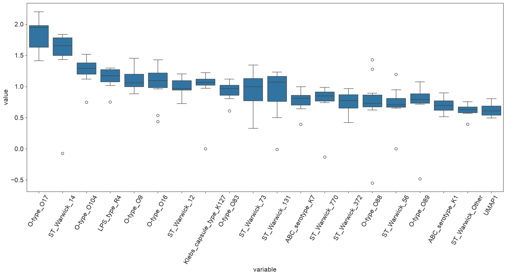
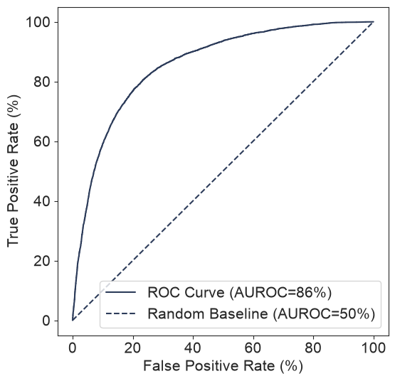
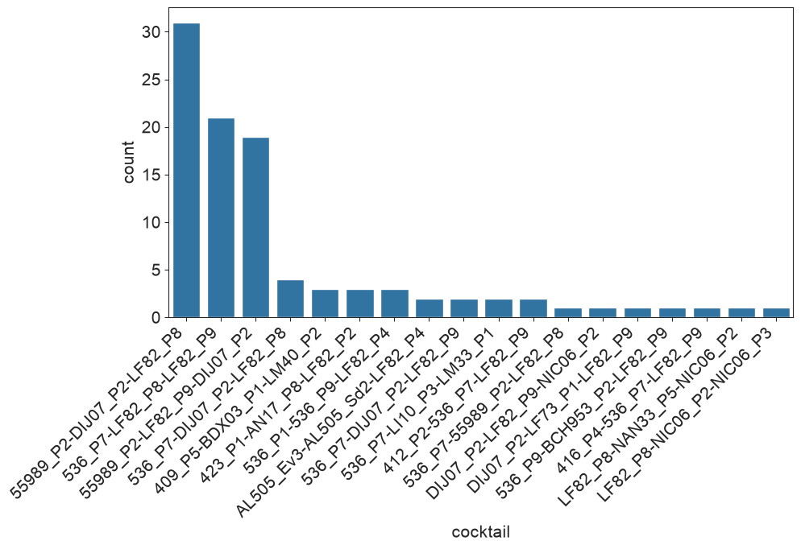

# 6. Figures

Every figure has a PNG, an SVG and a CSV with the numbers behind it, in `results/figures/` (panels of the paper) and `results/comparison/` (comparison with the paper). Scripts: `fig_main_1_2.py`, `fig1a_tree.py`, `fig_main_3_6.py`, `fig_extended.py`, `fig_phage_maps.py`, `fig_schematics.py`, `fig_comparison.py` (R fits: `fig4_cd.R`, `fig_ed6.R`). I assigned each panel a class from the legends of the published article:

- A: replicable from the shipped tables.
- B: replicable after the preprocessing steps are re-run.
- C: needs inputs that are not shipped.
- D: schematic, redrawn as a diagram.

## Coverage

| Panel | Content | Class | Status | File |
|---|---|---|---|---|
| Fig 1a | Core-genome tree with typing rings | B | drawn from our regenerated tree | `fig1a_tree` |
| Fig 1b-j | Collection descriptors (ST, O, pathotype, source, LPS, ABC, outer-membrane proteins, defense) | A | drawn | `fig1_b_j` |
| Fig 1k | Network of 1,122 phage genomes | C | not drawn: needs 1,026 GenBank genomes and vConTACT2 | none |
| Fig 2a-b | Plaque-assay and MLC schematics | D | redrawn | `schematic_fig2ab` |
| Fig 2c | Interaction matrix in tree order | A | drawn | `fig2_c` |
| Fig 2d-e | Host-range histograms | A | drawn | `fig2_d_e` |
| Fig 2f | Host range by morphotype, ANOVA | A | drawn, F = 113.9 (paper 114.7) | `fig2_f` |
| Fig 3a | Host-range UMAP, PERMANOVA | A | drawn | `fig3_a` |
| Fig 3b | Genome map and entropy of six Vectrevirus phages | C | drawn from re-annotated genomes (pyrodigal) and a MAFFT alignment | `fig3b_vectrevirus` |
| Fig 4a-b | Significant terms and hits per adsorption factor | A | drawn from our MCMC re-run | `fig4_a_d` |
| Fig 4c-d | Defense count vs infections and vs mean MLC | A | drawn with our fits | `fig4_a_d` |
| Fig 5a, c, d | AUROC per strain, AUROC vs lytic interactions of the strain, prediction matrix | A | drawn, with the paper's Source Data points overlaid on (c) | `fig5_a_c_d` |
| Fig 5b | Pooled ROC and precision-recall | A | drawn (Phase 4) | `results/repro/fig5_curves.png` |
| Fig 6a | Experiment schematic | D | redrawn | `schematic_fig6a` |
| Fig 6b | Tree of the 100 test strains | B | not drawn: test-strain genomes are not shipped | none |
| (Fig 6 recommender) | Our re-implementation of the recommender against the authors' cocktails | none | drawn as a comparison, not a paper panel | `cmp_recommender` |
| Fig 6c-e | Cocktails, success rate, binned MLC | A | drawn | `fig6_c_e` |
| ED1 | Lab-adapted strains | A | BE and BL21 drawn; MG1655 is not in the public matrix | `ed1` |
| ED2 | Nestedness and modularity | A | drawn with NODF and our BRIM (see below) | `ed2` |
| ED3 | RBP genes as variability hotspots | C | drawn for five genera from re-annotated genomes | `ed3_genus_maps` |
| ED4 | RBPs and host range | B | panel A drawn from the shipped matrix | `ed4a` |
| ED5 | PDP110_P1 and Klebsiella K55 | A | drawn | `ed5` |
| ED6 | Genome size and AMR genes vs MLC | A | all four panels drawn; the AMR counts are the paper's (Source Data) | `ed6_a_d` |
| ED7 | Coverage of the most-covering k-uplet | A | drawn; differs from the paper's curve, whose definition could not be derived | `ed7` |
| ED8 | Four-step recommender | D | redrawn (box titles from the legend only) | `schematic_ed8` |
| ED9 | Cocktails split into generic and tailored | A | drawn | `ed9` |

The paper uses new phage names and the public matrix keeps the old ones. The mapping (`results/comparison/phage_name_map.csv`, for example AL505_P3 = AL505_Sd2, T145_P2 = 412_P2, MT1B1_P3 = MT1B1_3A1, PDP110_P1 = 411_P1) is exact, because it comes from identical interaction vectors in Supplementary Table 3 and the public matrix. The figures use the 403-strain matrix of Supplementary Table 3 when the supplement has been downloaded (the public file lacks strain LF110).

ED2 uses NODF as the nestedness measure, because I had no implementation of the BINMATNEST temperature (the paper's Supplementary Text 5 gives T = 11.63). The modularity comes from a BRIM implementation I wrote, with 1,000 null matrices of the same size and connectance. It compares with the paper's Q = 0.23. The nestedness does not.

## Annotated figures

Conventions used in every figure unless the annotation says otherwise:

| Element | Meaning |
|---|---|
| Blue `#2a78d6` | this replication (or the data being described) |
| Orange `#eb6834` | the authors' shipped results or the paper's own numbers |
| Aqua `#1baf7a` | third series: this replication on regenerated inputs |
| Dashed black line | the paper's Source Data curve; dashed grey line = chance or a reference value |
| One-hue blue ramp (white to dark blue) | MLC score 0 to 4 in heat maps; light grey = pair not tested |
| Strains "in tree order" | the leaf order of the core-genome tree of the 402 to 403 strains |
| Phages "by genus" / "by host range" | sorted by morphotype, genus, then host range; or by the number of strains lysed, most first |
| CSV | every figure has a CSV with the plotted values next to the PNG and the SVG |

Each entry lists the panels, the axes and marks, the data file, how to read the figure, the numbers it shows, how it compares with the paper, and its caveats.

### Fig 1b-j: the collection

| Element | Annotation |
|---|---|
| Layout | 3 × 3 grid, panels b to j, in the order of the paper's Fig 1 |
| b, c | Horizontal bars, top 20 sequence types and top 20 O-antigens. x: number of strains (0 to 40). b: ST10 is the largest (40 strains), then ST58 and ST88 (17 each). c: "Oneg" (no O antigen called) 40, O2 29, O8 25, O6 21 |
| d, e | Horizontal bars: pathotype (ExPEC 186, commensal 172, no call 32, environment 6) and isolation source (faeces 176, urine 117, blood 52, no call 34) |
| f | LPS outer-core type: R1 206, R3 61, K12 43, R4 35, "No_waaL", R2, none |
| g | ABC-capsule serotype, all 16 classes: no ABC capsule 252, K1 42, K5 19, "HP" 13 |
| h | Number of variants (clusters at 99 % identity) of each of 12 outer-membrane proteins: NFRA 62, YNCD 55, OMPC 52 ... TSX 4 |
| i | Vertical bars: how many strains carry 1 to 16 defense subtypes; the mode is 8 subtypes (75 strains), then 9 and 10 (57 each) |
| j | Top 25 defense subtypes by number of strains: MazEF 340, RM_Type_I 328, RM_Type_IV 270, CAS class 1 subtype I-E 217 |
| Marks | Single blue, no legend needed (one series per panel); x gridlines only on horizontal bars |
| Data | `results/figures/fig1_b_j.csv` (columns panel, category, n); script `fig_main_1_2.py` |
| How to read | Bar length = number of strains in the 403-strain Picard collection with that value; "none" is a category, not missing data |
| Paper | Same panels; the collection size (403) matches. Panel j draws 25 of the 137 subtypes detected |
| Caveats | "Oneg" and "none" are the shipped table's own labels; defense subtypes are the shipped DefenseFinder calls, not the regenerated ones |

### Fig 1a: core-genome tree with typing rings

| Element | Annotation |
|---|---|
| Tree | Rectangular, midpoint-rooted tree of our regenerated PanACoTA/FastTree core genome; x = substitutions per site (root at the left); 403 leaves, one per row, no leaf labels |
| Rings | Four coloured strips right of the tree, in order: phylogroup, sequence type, O-type, H-type, labelled above each strip |
| Colours | `tab20`: the 12 most frequent values of each ring are coloured, everything else is light grey; colours are not comparable between rings |
| Data | `results/figures/fig1a_tree.csv` (ring, leaf, value); script `fig1a_tree.py`; ring values from the regenerated feature table |
| How to read | Long unbroken blocks of one colour in the phylogroup ring show the phylogroups (B2 126 strains, A 77, B1 45, C 36, D 24, E 20, clade I 19, G 16); the ST ring blocks are lineages; the O and H rings are patchier, which is the point of using ST and serotype together |
| Paper | Fig 1a draws the shipped tree with the authors' rings; this is an independent tree (normalised Robinson-Foulds 0.023 from the shipped one) |
| Caveats | Our serotype calls agree 100 % with the authors' raw ECTyper output but only 74.7 % (O) and 91.8 % (H) with their hand-curated columns, so the O and H rings differ from the paper's in the strains the authors curated by hand |

### Fig 2c: interaction matrix

| Element | Annotation |
|---|---|
| Axes | x: 403 strains in tree order; y: 96 phages, grouped by morphotype, then genus, then host range; no tick labels |
| Colours | Six categories: light grey = not tested, near-white = MLC 0 (no lysis), then four blues for MLC 1, 2, 3, 4 (dark = lysis at the lowest phage concentration, MLC 4 full clearing) |
| Data | `results/figures/fig2_c.csv` (strains × phages, public phage names); script `fig_main_1_2.py` |
| How to read | Vertical dark stripes = strains infected by many phages (generalist hosts); horizontal dark bands near the top = broad host-range phages (myoviruses); blocks of dark cells that follow the tree order show phylogenetic structure; the lower rows are mostly empty (narrow host range) |
| Numbers | 20.7 % of tested pairs are lytic |
| Paper | Same matrix, 403 strains with LF110 |
| Caveats | The paper colours the axes by phage genus and strain phylogroup; here they are ordered but not coloured |

### Fig 2d-e: host-range histograms

| Element | Annotation |
|---|---|
| d | Histogram, 20 bins. x: percentage of the 96 phages that infect a strain; y: number of strains. Mean 20.9 %, median 17.7 %, maximum 84.2 % |
| e | Histogram, 20 bins. x: percentage of the 403 strains that a phage infects; y: number of phages. Mean 20.7 %, median 14.2 %, from 0.7 % to 65.5 % |
| Data | `results/figures/fig2_d_e.csv`; script `fig_main_1_2.py` |
| How to read | Both distributions are right-skewed: most strains and most phages have a narrow range and a few are very broad |
| Paper | Same panels; no numbers printed in the legend |

### Fig 2f: host range by morphotype

| Element | Annotation |
|---|---|
| Axes | x: morphotype (Myoviridae 32 phages, Podoviridae 41, Siphoviridae 23); y: percentage of strains infected; one box per morphotype |
| Marks | Box = quartiles, black line = median, whiskers 1.5 IQR, circles = outliers; title gives the one-way ANOVA |
| Data | `results/figures/fig2_f.csv` (morphotype, pct_strains_infected); script `fig_main_1_2.py` |
| Numbers | Medians 42.5 % / 11.0 % / 7.0 %; means 41.3 / 11.2 / 9.1 (paper 41.3 / 11.1 / 9.1); ANOVA F = 114.7 with all 403 strains (paper 114.7); 113.9 with the public 402-strain matrix; the printed P of the paper (1.44e-26) is not the ANOVA P of these data (7.9e-26) |
| How to read | Myoviruses infect about four times as many strains as the other two morphotypes; podo- and siphoviruses overlap |

### Fig 3a: host-range UMAP of the phages

| Element | Annotation |
|---|---|
| Layout | Two scatter panels with the same coordinates: left coloured by genus, right by isolation strain |
| Axes | UMAP 1 and 2 (arbitrary units) of the Jaccard distance between the binary lytic vectors of the 96 phages (403 strains) |
| Marks | One dot per phage; the 8 most frequent genera (left) or isolation hosts (right) are coloured and listed in the legend, all others are grey |
| UMAP settings | 15 neighbours, minimum distance 0.1, seed 0 (the paper does not state its settings), so the layout is reproducible here but differs from the paper's |
| Data | `results/figures/fig3_a.csv` (phage, umap1, umap2, genus, isolation_strain); script `fig_main_3_6.py` |
| Numbers (not on the figure) | PERMANOVA adjusted R²: isolation strain 0.55 (paper 0.53); genus added after isolation strain 0.13 (0.13); both 0.69 (0.65); genus alone 0.27 |
| How to read | Phages of one genus or one isolation host sit close together; the colours cluster, and so do host letters, which is the visual form of the PERMANOVA result |
| Paper | The paper adds host-range heat maps of two zoomed regions; not drawn here |

### Fig 3b: six Vectrevirus phages

| Element | Annotation |
|---|---|
| Top left | Genome maps of LI10_P4, LI10_P5, 409_P5, 409_P3, LF31_P3 and 412_P2 (isolation host in brackets), 6 rows, genome length on x. Arrows = genes (direction = strand); light blue arrows = RBP genes, grey = other genes. Blue lines between neighbouring genomes join reciprocal best protein matches with at least 30 % amino-acid identity; thicker and darker line = higher identity |
| Bottom left | Position-wise entropy of the MAFFT whole-genome alignment of the six genomes: x = alignment position (nt), y = Shannon entropy of the nucleotide distribution (bits, 0 = identical in all six, mean over 200 nt) |
| Right | Host range of the six phages: rows = phages, columns = 403 strains in tree order, white to dark blue = MLC 0 to 4 |
| Data | `results/figures/fig3b_vectrevirus.csv` (genes), `fig3b_links.csv`, `fig3b_entropy.csv`; script `fig_phage_maps.py` |
| How to read | Most genes are linked all along the genome; the RBP genes (blue, early in the genome map) have few links and sit under the highest entropy peak (5 to 10 kb) |
| Numbers | Mean entropy 0.62 bits in the RBP genes against 0.24 bits in the other genes (alignment mean 0.25) |
| Paper | Same design (clinker map, entropy, host range); the paper's legend says "similarity", identity is used here |
| Caveats | Genes are called again with pyrodigal because the authors' annotation is not shipped; the RBP genes are located by the number in their identifier, so their position rests on the numbering convention of Prokka |

### Fig 4: what drives infection

| Element | Annotation |
|---|---|
| Layout | Four panels left to right: a, b, c, d |
| a | Two bars: significant terms (pMCMC < 1e-3) of the per-phage mixed models by class. Blue = adsorption factors (28, number printed above the bar), orange = defense systems (0). At the threshold the paper's Source Data actually uses (0.01) the counts are 51 and 3 (paper 52 and 1) |
| b | Horizontal grouped bars: for each adsorption-factor family, the number of phages with a significant term. Blue = this re-run (adsorption factors + defense systems in the model), orange = the authors' shipped model (adsorption factors only). Families from the top: LPS type (14 vs 9), ABC serotype (12 vs 13), OMPA (1 vs 1), O-type (1 vs 2), Klebsiella capsule (0 vs 1), YNCD (0 vs 1) |
| c | Scatter, one dot per strain (402): x = number of defense systems of the strain, y = number of phages lysing it. Title: β of the Gaussian mixed model with the phylogeny as random effect, its pMCMC, and the paper's values: β -0.22, pMCMC 0.41 (here -0.223, 0.40) |
| d | Same x (390 strains with at least one lytic interaction), y = average MLC of the strain over the phages that infect it. Title as in c; paper β -0.04, pMCMC 0.004 (here -0.033, 0.0005) |
| Marks | Blue dots with transparency (overlapping points darker); no regression line is drawn because the fit is a mixed model, not a straight line |
| Data | `results/figures/fig4_a_d.csv`; fits in `results/fig4_summary/` (`fig4cd.csv`, `af_hits_by_family.csv`); scripts `fig_extended.py`, `fig4_cd.R`, `fig4_mcmc.R` |
| How to read | a, b: adsorption factors, mainly LPS and ABC capsule, explain infection; defense systems do not. c, d: more defense systems go with no more or fewer lytic interactions (c) and only a slightly lower average MLC (d) |
| Paper | Same four panels; its counts of a are at pMCMC 0.01 and its panel d uses a smaller defense count than panel c (the Source Data columns differ for 353 of 400 strains) |
| Caveats | Five phages needed an extra prior to fit; a and b are re-run on all 402 strains (the authors' Rmd silently dropped 136) |

### Fig 5: prediction performance

| Element | Annotation |
|---|---|
| Layout | Four panels: a, the preprint's per-phage panel, c, d |
| a | Histogram of the AUROC of each strain (one AUROC per strain from the pooled out-of-fold predictions of the 96 phage models; strains with one class only are left out, n = 390). x: AUROC 0.3 to 1; y: number of strains. Dashed line = mean 0.878 |
| Second panel | Histogram of the AUROC of each phage (96 models, group 10-fold cross-validation, best model by AUPR); dashed line = mean 0.787. This is what the preprint called the average AUROC (77 %) |
| c | Scatter, one dot per strain: x = lytic interactions of the strain, y = its AUROC. Blue filled dots = this run; orange open circles = the paper's Source Data (315 strains). The two clouds overlap |
| d | Prediction matrix at threshold 0.5. Rows: 96 phages by host range (most lytic at the top); columns: strains in tree order. Blue = true positive (4,669 pairs), light orange = false positive (2,940), orange = false negative (3,307), pale grey = true negative or not tested |
| Data | `results/figures/fig5_a_c_d.csv` (per strain), `fig5_per_phage_auroc.csv`, `fig5_d_prediction_matrix.csv`; script `fig_main_3_6.py` |
| How to read | a: most strains are predicted well (median 0.89, 10 % below 0.77); c: strains with few lytic interactions have the widest spread; d: errors cluster in vertical stripes (strains the models treat alike) and at the lower left (rare phages) |
| Paper | Fig 5a plots one AUROC per strain; its text says 85 % while its own Source Data averages 0.872 (here 0.881 on the same 315 strains) |

| Element | Annotation |
|---|---|
| Layout | Left: ROC curve; right: precision-recall curve, pooled over all 38,436 predicted pairs of the 96 phages |
| Marks | Blue = this re-run, orange = the authors' shipped predictions; dashed grey = chance (diagonal; precision 0.21 = prevalence); legends give AUROC 0.856 and 0.857 and average precision 0.598 and 0.601 |
| Data | `results/repro/predictions.csv`; script `fig5_curves.py` |
| How to read | The two curves coincide: the re-run reproduces the authors' pooled performance |

### Fig 6: the cocktail experiment

| Element | Annotation |
|---|---|
| Boxes (left to right, arrows between them) | Interaction matrix 403 × 96 → recommender trained on it → 100 unseen E. coli (genomic traits only) → three-phage cocktail per strain → tested at six concentrations (5×10³ to 5×10⁸ pfu/ml) against the baseline triplet |
| Source | Redrawn from the paper's legend; the box text is the legend's wording only |
| Panel 6b | Not drawn: the tree of the 100 test strains needs their genomes, which are not shipped |

| Element | Annotation |
|---|---|
| c | Bar chart of the 18 distinct cocktails, sorted by the number of test strains they were recommended for (y), no x labels. Orange = generic cocktails (31, 22, 19, 4 strains), blue = tailored cocktails (14 cocktails for 24 strains in all) |
| d | Success rate (% of strains lysed by the three-phage cocktail): tailored 91.7 %, generic 78.9 %, baseline (the most-covering triplet, tested on all 100 strains) 81.0 % |
| e | Distribution of the MLC of the cocktail binned 0, 1 to 2, 3 to 4, 5 to 6: for each bin, the percentage of strains for tailored (blue), generic (orange) and baseline (grey) |
| Data | `results/figures/fig6_c_e.csv`; script `fig_main_3_6.py` |
| Statistics | tailored vs baseline on the tailored strains Mann-Whitney U = 399.5, P = 0.019; tailored vs generic U = 1171.5, P = 0.034 (the paper's legend: the same) |
| How to read | Tailored cocktails lyse more strains and at lower phage concentrations (more of the strains fall in the highest MLC bin) than generic ones or the baseline |
| Caveats | The test used 24 tailored and 76 generic strains (the notebook's split); Supplementary Table 7 labels 28 and 72. The recommender itself was not re-run |

## Extended Data

### ED1: laboratory-adapted strains

| Element | Annotation |
|---|---|
| Axes | Two rows (BE and BL21) × 96 phages (x, sorted by morphotype then genus); colour bar on the right: MLC 0 (white) to 4 (dark blue) |
| Data | `results/figures/ed1.csv`; script `fig_extended.py` |
| Numbers | BE is infected by 45 phages (46.9 %), BL21 by 48 (50.0 %), as in the paper's legend |
| Paper | The paper also shows MG1655 (tested at one concentration), which is not in the public matrix |

### ED2: nestedness and modularity

| Element | Annotation |
|---|---|
| Left | The binary matrix with rows (phages) and columns (strains) sorted by decreasing number of lytic interactions; dark = lytic. A nested matrix piles dark cells in the upper left, as here |
| Middle | Histogram of NODF for 1,000 random matrices of the same size and connectance (light blue); orange line = observed NODF 52.1 (null mean 21.5, SD 0.24, P = 0.001) |
| Right | Histogram of the BRIM modularity of the same random matrices; orange line = observed Q 0.233 with 4 modules (null mean 0.122, SD 0.003, P = 0.001) |
| Data | `results/figures/ed2.csv`; functions in `matrix_stats.py` |
| How to read | The observed values lie far to the right of the null: the matrix is strongly nested and weakly modular |
| Paper | Supplementary Text 5: Q = 0.23 (matches) and a BINMATNEST temperature T = 11.63 (no counterpart; NODF is a different measure) |

### ED3: RBP genes in five genera

| Element | Annotation |
|---|---|
| Layout | Five stacked panels, one per genus: Vectrevirus, Dhillonvirus, Gamaleyavirus, Felixounavirus, Tequatrovirus; each shows up to four phages from different isolation hosts (host in brackets) |
| Marks | Arrows = genes, light blue = RBP genes; lines between neighbouring genomes = reciprocal best protein matches with at least 30 % identity (thicker and darker = more identical) |
| Data | `results/figures/ed3_genus_maps.csv` (genes), `ed3_links.csv`; script `fig_phage_maps.py` |
| How to read | Within a genus almost every gene is linked to its counterpart in the next genome; the light-blue RBP genes are the gaps where the links stop or are weak |
| Caveats | Genes are re-called (pyrodigal); phages are picked by name from distinct hosts, not as in the paper; only one phage per isolation host is shown, so Dhillonvirus (4 phages with an RBP annotation) and Gamaleyavirus (3) show two |

### ED4A: three phages with a shared RBP

| Element | Annotation |
|---|---|
| Axes | x: strains in tree order; four rows: "ABC K1" (dark = the strain carries a K1 ABC capsule), then AL505_Sd2, 412_P2 and MT1B1_3A1 (public names of AL505_P3, T145_P2, MT1B1_P3; dark blue = lysis, MLC 0 to 4) |
| Data | `results/figures/ed4a.csv`; script `fig_extended.py` |
| Numbers | The three phages infect 77, 53 and 68 strains, of which 36, 36 and 37 carry a K1 capsule (42 K1 strains in all) |
| How to read | The dark cells of the phage rows line up with the K1 row: the three phages infect mostly K1 strains, although they belong to two genera |

### ED5: PDP110_P1 and the K55 capsule

| Element | Annotation |
|---|---|
| Axes | x: strains in tree order; two rows: "Klebsiella K55 locus" (dark = K55 called) and "PDP110_P1 (411_P1) lysis" (dark = lysis) |
| Data | `results/figures/ed5.csv`; script `fig_extended.py` |
| Numbers | Both rows have exactly the same three dark cells (PDP110, NILS06, IAI34): the phage infects exactly the K55 strains, as in the paper |
| Caveats | On the regenerated matrix PDP110 (an isolation strain) is absent, leaving two strains; our Kaptive misses K55 in PDP110 |

### ED6: genome size and AMR genes

| Element | Annotation |
|---|---|
| Layout | 2 × 2 scatter plots. Columns: genome size (A, C; Mb, from our assemblies) and number of AMR genes (B, D; the paper's counts); rows: lytic interactions of the strain (A, B) and its average MLC (C, D) |
| Marks | Blue dots, one per strain, transparency shows overlap; panel titles give β of the Gaussian mixed model (phylogeny as random effect) per Mb or per gene and its pMCMC |
| Data | `results/figures/ed6_a_d.csv` (our columns only; the AMR counts and the paper's genome sizes are the publisher's and are not redistributed); fits in `results/fig4_summary/ed6.csv`; scripts `fig_extended.py`, `fig_ed6.R` |
| Numbers | A: β -5.85, pMCMC 0.12; B: -0.47, 0.047; C: -0.35, 0.003; D: -0.021, 0.0105 |
| How to read | Larger genomes go with a lower average MLC (C) and not with the number of lytic interactions (A); AMR genes are not clearly related to either (B, D) |
| Paper | Title of the ED figure: genome size correlates with virulence, AMR genes do not |

### ED7: coverage by the most-covering phage sets

| Element | Annotation |
|---|---|
| Axes | x: k = number of phages in the set (1 to 25); y: percentage of the 403 strains lysed by at least one of them |
| Marks | Blue line with markers; dashed horizontal line at the triplet's value, labelled "best triplet 87.6 %" |
| Data | `results/figures/ed7.csv`; function `coverage_curve` in `matrix_stats.py` (exact for k ≤ 3, greedy beyond) |
| Numbers | 65.5 % (k = 1), 80.4 % (2), 87.6 % (3: 536_P7, LF82_P8, NIC06_P2), 90.8 % (4), 96.5 % (10), 97.0 % (25) |
| How to read | Three phages already cover most of what the collection can lyse; the curve saturates near 97 % |
| Paper | The paper's Source Data curve starts at 42.7 % and ends at 89.3 %; no definition of "productive lysis" reproduces it (see report 05) |

### ED9: generic and tailored cocktails

| Element | Annotation |
|---|---|
| A | Grouped bars: for tailored (blue) and generic (orange) cocktails, the percentage of recommended phages chosen at each step. The labels "step 0, 1, 3, 4" are the step names of the authors' file: 0 = similar to the isolation strain (the paper's step 1), 1 = same-haplotype neighbours (step 2), 3 = trait matching, 4 = rescue with the most generalist phages. Tailored: 76.4 % at step 0; generic: 38.7 % at step 0 and 58.7 % at steps 3 and 4 |
| B | One bar per cocktail (18), sorted: number of ST/O/H haplotypes of the strains it was recommended for; orange = the four generic cocktails (20, 18, 18, 4), blue = the fourteen tailored ones (1 or 2) |
| Data | `results/figures/ed9.csv`; script `fig_extended.py` |
| Statistics | Mann-Whitney on the per-strain mean step: P = 6.4e-5 with each strain once; 3.5e-12 (the paper's value) when each strain is counted three times, as in the authors' notebook |
| How to read | Tailored cocktails come mostly from phages matched to the strain's own host; generic cocktails cover many haplotypes with the same few generalist phages |
| Caveats | The Source Data of the paper's panel B holds strain counts (31, 21, 19, 4), not haplotype counts |

### Schematics

| Element | Annotation |
|---|---|
| Boxes | Top row: the phage × bacterial-lawn assay (three replicates) and the three phage concentrations 5×10⁸, 5×10⁷, 5×10⁶ pfu/ml (phage:bacteria ratio about 10, 1, 0.1). Bottom row: MLC 0 (no lysis at any concentration) and the score given when the lawn is lysed at the lowest concentration where lysis is seen: 1, 2, and 3 (plaques) or 4 (full clearing) |
| Rule shown | The score is the lowest phage concentration that lyses the lawn: a lower concentration means a higher MLC |
| Source | Redrawn from the legend of Fig 2a-b |

| Element | Annotation |
|---|---|
| Boxes | The four steps of the recommender, left to right: 1 similar as the isolation strain, 2 similar as strains in the Picard collection, 3 trait matching, 4 rescue; arrows between them |
| Rule shown | Rank phages by predicted probability, add the top ones when p > 0.5, stop at three phages, never two phages of the same genus and isolation strain |
| Source | Redrawn from the legend; only the four box titles come from the figure |

## Comparison figures

### Headline numbers against the paper

| Element | Annotation |
|---|---|
| Axes | One row per paper number that has a numeric counterpart (labels on the left: figure and metric). x: our value divided by the paper's value; vertical black line at 1 (exact agreement); grey band = within 5 % |
| Marks | Blue dot = this replication on the shipped inputs; orange dot = on the regenerated inputs (only for rows that have one) |
| Data | `results/comparison/cmp_headline.csv`; script `fig_comparison.py` |
| How to read | A dot inside the band agrees with the paper within 5 %; far-out dots are the rows that differ: ED7 coverage (1.3 to 1.5 times the paper's), the K1 recall and precision (0.76 and 1.19, 2.6 for the other phages), the recommender (0.02 identical cocktails, 0.32 phages in common), the defense-only PERMANOVA R² (3.4) and the RBP-count β (negative against a positive paper value). Rows beyond the axis are drawn at its edge as triangles with the value beside them. 52 rows; P-values and rows that are not one number on both sides are left out |

### Pooled ROC and precision-recall

| Element | Annotation |
|---|---|
| Left: ROC | x: false positive rate, y: true positive rate, both 0 to 1. Orange = the authors' shipped predictions (AUROC 0.857), blue = this run on the shipped inputs (0.856), aqua = this run on regenerated inputs (0.855), black dashed = the curve of the paper's Source Data (AUROC 0.849 from its points), grey dashed = chance |
| Right: precision-recall | x: recall, y: precision. Orange, blue and aqua as on the left (average precision 0.601, 0.598, 0.596); dashed grey horizontal = chance (prevalence 0.21). The paper's precision-recall block holds only the tail (recall 0.945 to 1), so it is not drawn |
| Data | `results/comparison/cmp_roc_pr.csv` (the paper's points are the publisher's data and are not in the CSV); script `fig_comparison.py` |
| How to read | Curves that lie on top of each other mean identical pooled performance; the paper's curve lies slightly below |

### Per-phage AUROC against the authors' values

| Element | Annotation |
|---|---|
| Axes | x: AUROC of each of the 96 phage models in the authors' shipped results; y: AUROC of the same phage in this run (0.45 to 1); dashed diagonal = identical |
| Marks | Blue = shipped inputs (r = 0.92), orange = regenerated inputs (r = 0.79); one dot per phage per colour |
| Data | `results/comparison/cmp_per_phage_auroc.csv` (also `per_phage_auroc.csv`); script `fig_comparison.py` |
| How to read | Dots on the diagonal agree; the orange cloud is wider because the inputs were regenerated; a few phages with few lytic strains move by more than 0.1 |

### Agreement of the regenerated features

| Element | Annotation |
|---|---|
| Left | Horizontal bars (x from 0 to 100 %): agreement of each regenerated typing feature with the shipped table at strain level (O-type raw 100 %, ABC presence 98.3 %, phylogroup 99.0 %, Kaptive 97.3 %, LPS 97.0 %, ST 95.3 %, ABC K-type 89.5 %, H-type 91.8 %, O-type curated 74.7 %, and the 33 isolation strains) |
| Right | Horizontal bars (x from 0 to 1): agreement of the clusterings and counts: adjusted Rand index for the CV groups (0.98), the 12 outer-membrane clusterings (0.06 for tolC to 0.96 for ompC), 10-NN overlap for UMAP (0.75), F1 for defense subtypes (0.98), Pearson r for tree distances and defense counts |
| Data | `results/comparison/cmp_feature_agreement.csv`; source `results/replication/phase6_summary.csv`; script `fig_comparison.py` |
| How to read | Long bars = the regenerated feature matches; the short bars (tolC, fadL, nfrA, curated O-type) are the least reproducible features |

### Feature ablation on both input sets

| Element | Annotation |
|---|---|
| Axes | y: the feature group (or combination) removed; x: change in per-phage AUROC when it is removed (negative = the model gets worse) |
| Marks | Blue dot = shipped inputs, orange dot = regenerated inputs, grey segment joins the two for the same group; vertical line at 0 |
| Data | `results/comparison/cmp_ablation.csv`; script `fig_comparison.py` |
| How to read | Dots far left (ABC capsule -0.021, LPS -0.016) are features the model needs; dots near zero (O-type, ST, UMAP) can be removed alone; the all-phylogeny removal moves from -0.012 (blue) to -0.003 (orange) |

### Recommender against the authors' cocktails

| Element | Annotation |
|---|---|
| Left | Bars: number of the 100 test strains whose three-phage cocktail shares 0, 1, 2 or 3 phages with the authors' cocktail (15, 75, 8, 2; numbers above the bars) |
| Right | Grouped bars: percentage of recommended phages chosen at each of the four steps. Orange = the authors (48 % step 1, 4 % step 2, 26 % step 3, 22 % step 4), blue = this re-implementation (32 %, 23 %, 8 %, 37 %) |
| Data | `results/comparison/cmp_recommender.csv`, `results/recommender/`; script `fig_comparison.py` |
| How to read | Bars at 3 would mean the same cocktail; most cocktails share only one phage, and the re-implementation leans on step 2 and step 4 where the authors lean on steps 1 and 3 |

## Figures from the authors' notebooks (run in `notebooks/`)

| Element | Annotation |
|---|---|
| Axes | x: model feature (one-hot column); y: importance value over the phage-specific models that use it (box per feature: quartiles, whiskers, circles = outliers), sorted from the most important |
| Source | cell 6 of `visualize_predictions.ipynb`; the highest boxes are O-type O17, ST 14, O-type O104, LPS type R4 |
| How to read | A few specific O types, sequence types and LPS types carry the most weight in the per-phage models |

| Element | Annotation |
|---|---|
| Axes | False and true positive rate in percent; solid curve = pooled ROC of the authors' shipped predictions (AUROC 86 %), dashed = random (50 %) |
| Source | cell 16 of `visualize_predictions.ipynb` |

| Element | Annotation |
|---|---|
| Axes | x: the 18 recommended cocktails (rotated labels = the three phage names); y: number of strains (31, 21, 19, 4, then 3, 3, 3, 2 ... 1) |
| Source | cell 4 of the cocktail notebook; it counts 99 strains because the notebook's merge loses the strain BCH857 (named BCH857-72 in `cocktails_step.csv`), so the third bar is 21 and not 22 |

## Colour and checks

Two-series charts use the blue `#2a78d6` and orange `#eb6834` of the reference palette. Each has a legend, none has two y axes, and the grid and axes are muted. The palette validator of the visualisation skill would not run on this machine (its Node binary lacked a library), so I used the palette's documented slots and checked each figure by eye.
