# 6. Figures

Every figure has a PNG, an SVG and a CSV with the numbers behind it, in `results/figures/` (panels of the paper) and `results/comparison/` (comparison with the paper). Scripts: `fig_main_1_2.py`, `fig1a_tree.py`, `fig_main_3_6.py`, `fig_extended.py`, `fig_phage_maps.py`, `fig_schematics.py`, `fig_comparison.py` (R fits: `fig4_cd.R`, `fig_ed6.R`). The class of each panel was decided from the legends of the published article:

- **A** replicable from the shipped tables, **B** after the preprocessing steps are re-run, **C** needs inputs not shipped, **D** schematic (redrawn as a diagram).

## Coverage

| Panel | Content | Class | Status | File |
|---|---|---|---|---|
| Fig 1a | Core-genome tree with typing rings | B | drawn from our regenerated tree | `fig1a_tree` |
| Fig 1b–j | Collection descriptors (ST, O, pathotype, source, LPS, ABC, outer-membrane proteins, defense) | A | drawn | `fig1_b_j` |
| Fig 1k | Network of 1,122 phage genomes | C | not drawn: needs 1,026 GenBank genomes and vConTACT2 | – |
| Fig 2a–b | Plaque-assay and MLC schematics | D | redrawn | `schematic_fig2ab` |
| Fig 2c | Interaction matrix in tree order | A | drawn | `fig2_c` |
| Fig 2d–e | Host-range histograms | A | drawn | `fig2_d_e` |
| Fig 2f | Host range by morphotype, ANOVA | A | drawn, F = 113.9 (paper 114.7) | `fig2_f` |
| Fig 3a | Host-range UMAP, PERMANOVA | A | drawn | `fig3_a` |
| Fig 3b | Genome map and entropy of six Vectrevirus phages | C | drawn from re-annotated genomes (pyrodigal) and a MAFFT alignment | `fig3b_vectrevirus` |
| Fig 4a–b | Significant terms and hits per adsorption factor | A | drawn from our MCMC re-run | `fig4_a_d` |
| Fig 4c–d | Defense count vs infections and vs mean MLC | A | drawn with our fits | `fig4_a_d` |
| Fig 5a, c, d | AUROC per strain, AUROC vs lytic interactions of the strain, prediction matrix | A | drawn, with the paper's Source Data points overlaid on (c) | `fig5_a_c_d` |
| Fig 5b | Pooled ROC and precision–recall | A | drawn (Phase 4) | `results/repro/fig5_curves.png` |
| Fig 6a | Experiment schematic | D | redrawn | `schematic_fig6a` |
| Fig 6b | Tree of the 100 test strains | B | not drawn: test-strain genomes are not shipped | – |
| (Fig 6 recommender) | Our re-implementation of the recommender against the authors' cocktails | – | drawn as a comparison, not a paper panel | `cmp_recommender` |
| Fig 6c–e | Cocktails, success rate, binned MLC | A | drawn | `fig6_c_e` |
| ED1 | Lab-adapted strains | A | BE and BL21 drawn; MG1655 is not in the public matrix | `ed1` |
| ED2 | Nestedness and modularity | A | drawn with NODF and our BRIM (see below) | `ed2` |
| ED3 | RBP genes as variability hotspots | C | drawn for five genera from re-annotated genomes | `ed3_genus_maps` |
| ED4 | RBPs and host range | B | panel A drawn from the shipped matrix | `ed4a` |
| ED5 | PDP110_P1 and Klebsiella K55 | A | drawn | `ed5` |
| ED6 | Genome size and AMR genes vs MLC | A | all four panels drawn; the AMR counts are the paper's (Source Data) | `ed6_a_d` |
| ED7 | Coverage of the most-covering k-uplet | A | drawn; differs from the paper's curve, whose definition could not be derived | `ed7` |
| ED8 | Four-step recommender | D | redrawn (box titles from the legend only) | `schematic_ed8` |
| ED9 | Cocktails split into generic and tailored | A | drawn | `ed9` |

The paper uses new phage names; the public matrix keeps the old ones. The mapping (`results/comparison/phage_name_map.csv`, for example AL505_P3 = AL505_Sd2, T145_P2 = 412_P2, MT1B1_P3 = MT1B1_3A1, PDP110_P1 = 411_P1) is exact: it comes from identical interaction vectors in Supplementary Table 3 and the public matrix. The figures use the 403-strain matrix of Supplementary Table 3 when the supplement has been downloaded (the public file lacks strain LF110).

ED2 uses NODF as the nestedness measure because the BINMATNEST temperature has no implementation here (the paper's Supplementary Text 5 gives T = 11.63), and a BRIM modularity written for this work (1,000 null matrices with the same size and connectance). The modularity is comparable with the paper's Q = 0.23; the nestedness is not.

## Main figures

### Fig 1: the collection

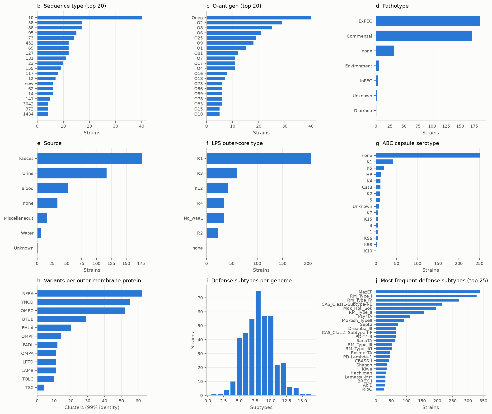

Bar charts of the 403 strains by sequence type, O-antigen, pathotype, source, LPS outer-core type and ABC capsule serotype; the number of variants of each of the 12 outer-membrane proteins; defense subtypes per genome; and the 25 most frequent defense subtypes (137 subtypes in all). The strain count (403) matches the paper.

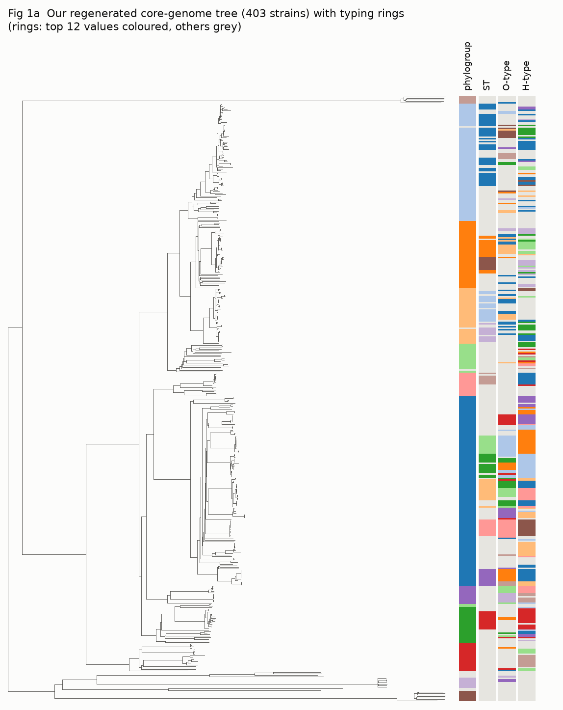

Our own core-genome tree (PanACoTA and FastTree, rooted at the midpoint) with rings for phylogroup, sequence type, O-type and H-type taken from the regenerated feature table. The ring colours show the 12 most frequent values; everything else is grey.

### Fig 2: the interaction matrix

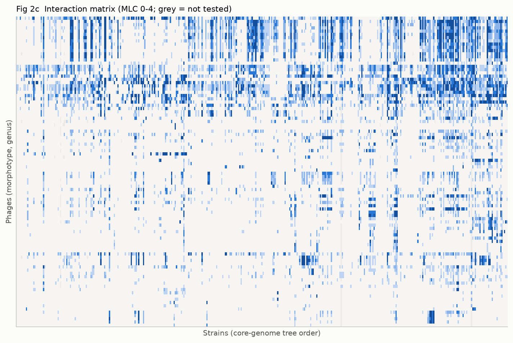
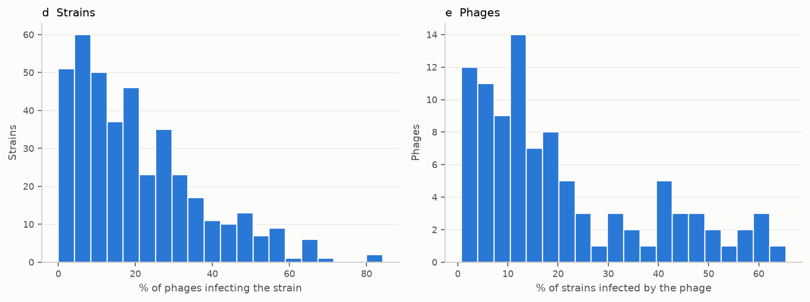

The matrix of MLC scores 0–4 with strains in core-genome tree order and phages grouped by morphotype and genus; the share of phages that infect each strain and of strains each phage infects (mean 20.7 % of strains per phage); and host range by morphotype. Myoviruses infect 41.3 % of strains on average, podoviruses 11.2 % and siphoviruses 9.1 % (paper: 41.3, 11.1, 9.1). One-way ANOVA F = 114.7 with all 403 strains, as in the paper.

### Fig 3: host-range similarity of the phages

UMAP of the Jaccard distance between the binary lytic vectors of the 96 phages, coloured by genus (left) and by isolation strain (right). PERMANOVA adjusted R²: isolation strain 0.55 (paper 0.53), genus and isolation strain together 0.69 (0.65), and genus added after isolation strain 0.13 (paper 0.13; genus alone gives 0.27).

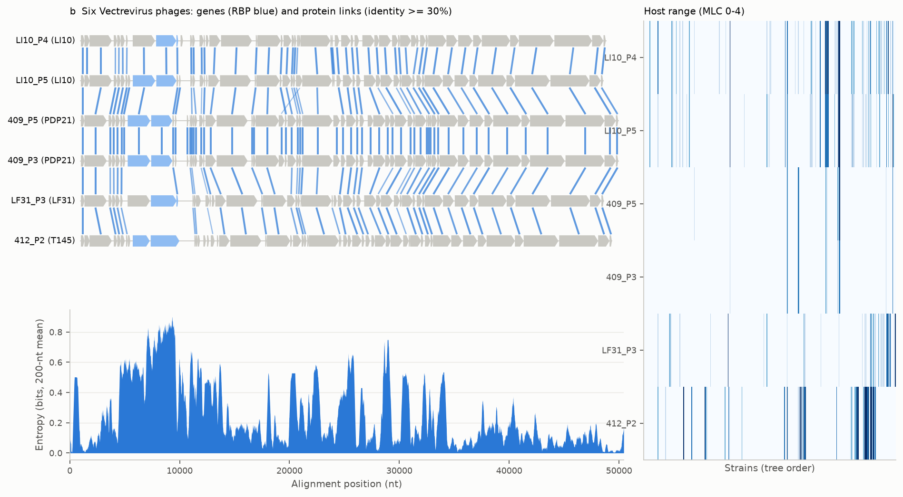

(b) Six Vectrevirus phages isolated on four hosts: genes (RBP genes in blue, located by the number in their identifier), protein links of at least 30 % identity between neighbouring genomes, position-wise entropy of the MAFFT alignment and host range. Mean entropy is 0.62 bits in the RBP genes against 0.24 bits elsewhere. The authors' annotation is not shipped, so the genes are called again ([10](10_repository_analyses.md)).

### Fig 4: what drives infection

(a) Significant terms in the per-phage mixed models: 28 adsorption-factor terms and no defense-system term at the Methods threshold (pMCMC < 1e-3); at 0.01, the threshold the paper's Source Data actually uses, 51 and 3 (paper 52 and 1). (b) Terms per adsorption factor, this re-run against the authors' shipped adsorption-factor-only model (LPS 14 vs 9, ABC capsule 12 vs 13). (c, d) Number of defense systems against lytic interactions per strain (β −0.233, pMCMC 0.40; paper −0.22, 0.41) and against average MLC (β −0.033, pMCMC 0.0003; paper −0.04, 0.004).

### Fig 5: prediction performance

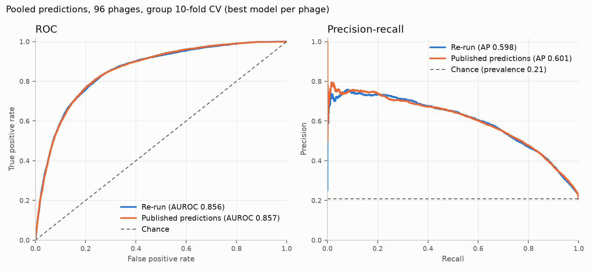

(a) AUROC per strain (mean 0.878 over the 390 strains with both classes; 0.881 on the 315 strains of the paper's Source Data, whose mean is 0.872); the second histogram is the per-phage AUROC the preprint reported (mean 0.787). (c) AUROC of each strain against its number of lytic interactions (this run in blue, the paper's Source Data points as orange circles; Spearman −0.19 here). (d) Predicted against observed lysis over the 38,436 predicted pairs at threshold 0.5 (4,669 true positives, 2,940 false positives, 3,307 false negatives). (b) Pooled ROC and precision–recall curves of this run against the authors' shipped predictions; the comparison with the paper's curve is in [05](05_paper_comparison.md).

### Fig 6: the cocktail experiment

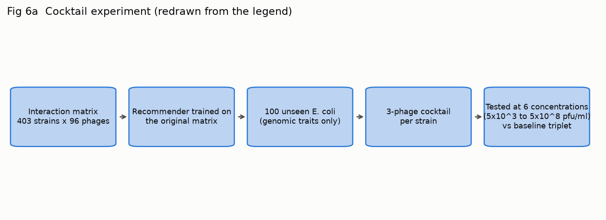

(a) Schematic redrawn from the legend (box text from the legend only). Panel (b), the tree of the 100 test strains among the 403, is not drawn because the test-strain genomes are not shipped.

(c) The 18 distinct cocktails and the number of test strains each was recommended for: four generic cocktails cover 76 strains (31, 22, 19 and 4), fourteen tailored cocktails cover 24. (d) In vitro success rate: tailored 91.67 %, generic 78.95 %, baseline (the most-covering triplet) 81 %, identical to the paper. (e) Distribution of the binned MLC of the three-phage cocktail: tailored against baseline Mann–Whitney U = 399.5, P = 0.019; tailored against generic U = 1171.5, P = 0.034, both identical to the paper's legend. These panels re-analyse the shipped experimental results. The recommender was re-implemented separately from the Methods and does not reproduce the authors' cocktails (2 of 100 identical; [05](05_paper_comparison.md)). The paper's Source Data lists the same 18 cocktails with 99 strains, and 17 of the 18 counts equal ours (536_P7-LF82_P8-LF82_P9: 21 against 22).

## Extended Data

### ED1: laboratory-adapted strains

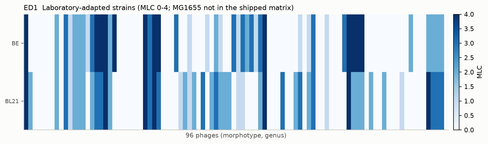

MLC of the 96 phages on BE and BL21: 45 phages infect BE (46.9 %) and 48 infect BL21 (50.0 %), as in the paper's legend. MG1655, tested at a single concentration, is not in the public matrix.

### ED2: nestedness and modularity

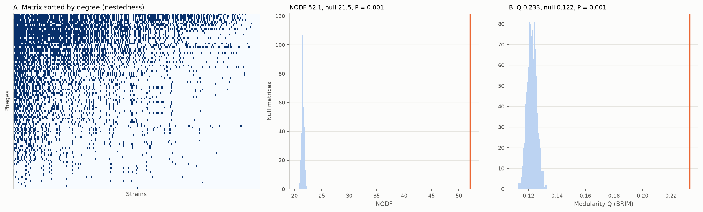

Left: the matrix sorted by degree. Middle: NODF 52.1 against 21.5 ± 0.24 for 1,000 random matrices of the same size and connectance (P = 0.001). Right: BRIM modularity Q = 0.233 with 4 modules against 0.122 ± 0.003 (P = 0.001); the paper's Supplementary Text 5 gives Q = 0.23 (P < 1e-3). The paper's nestedness is a BINMATNEST temperature (T = 11.63, P < 1e-5), which has no counterpart here.

### ED3: RBP genes as hotspots of variability

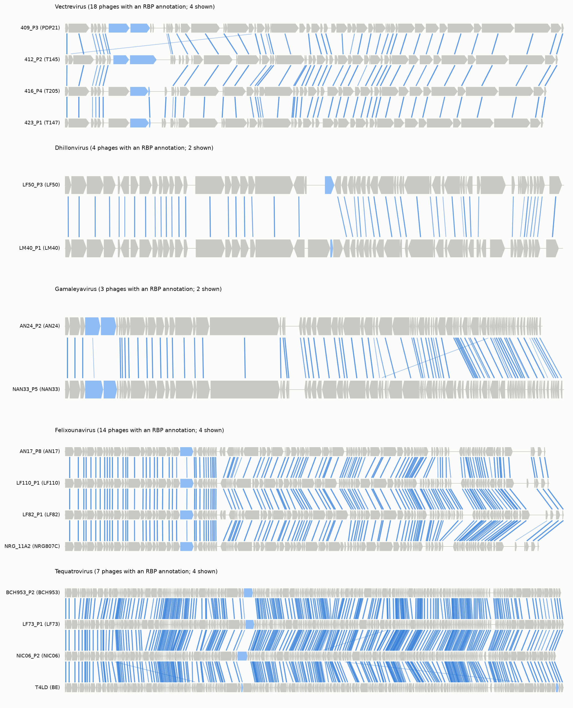

Genome maps of up to four phages of different isolation hosts for Vectrevirus, Dhillonvirus, Gamaleyavirus, Felixounavirus and Tequatrovirus; links join protein matches of at least 30 % identity, RBP genes are light blue. The RBP genes have few or no links in every genus.

### ED4: receptor-binding proteins and host range

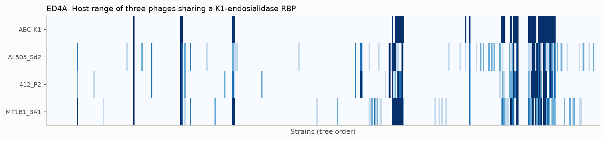

Panel A: the host range of three phages with a similar receptor-binding protein, over the strains in tree order, with the K1 ABC capsule marked in the top row. AL505_Sd2 infects 77 strains (36 K1), 412_P2 infects 53 (36 K1) and MT1B1_3A1 infects 68 (37 K1); 42 strains carry a K1 capsule. The phage names are the public names of AL505_P3, T145_P2 and MT1B1_P3.

### ED5: PDP110_P1 and the Klebsiella K55 capsule

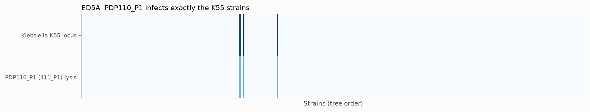

PDP110_P1 (public name 411_P1) infects three strains, and these are exactly the three strains with a K55 capsule locus, as in the paper.

### ED6: genome size and AMR genes against infection

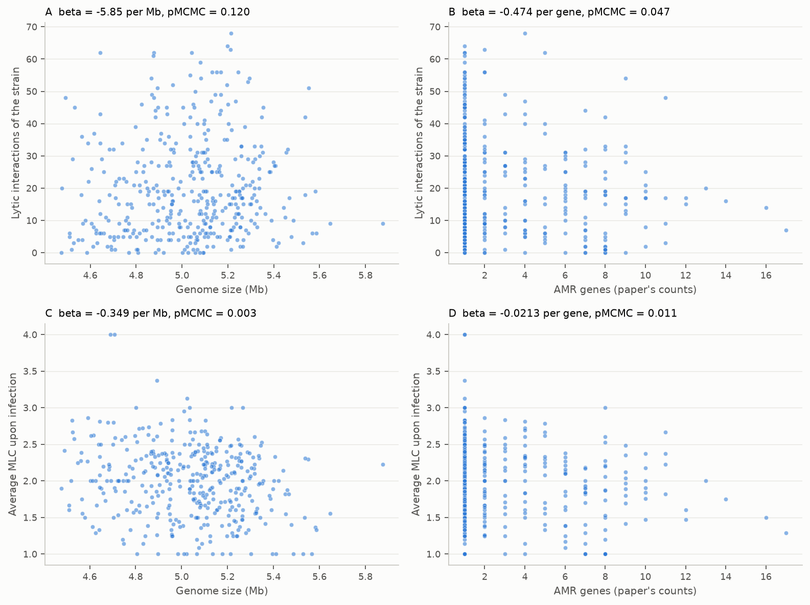

Genome size (from our assemblies) and the number of AMR genes (the paper's counts from its Source Data, since no AMR annotation is shipped) against the lytic interactions of a strain (A, B) and its average MLC (C, D), by the same mixed model as Fig 4c–d. The CSV of this figure holds only our columns; the paper's AMR counts and genome sizes are the publisher's data and are read from the downloaded supplement. Genome size against average MLC is significant (C, β −0.35 per Mb, pMCMC 0.003; with the paper's own genome sizes 0.001); against lytic interactions it is not (A, 0.12). AMR genes are not significant at 0.01 (B 0.047, D 0.0105, borderline). This agrees with the paper's title: genome size correlates with virulence, AMR genes do not.

### ED7: coverage by the most-covering phages

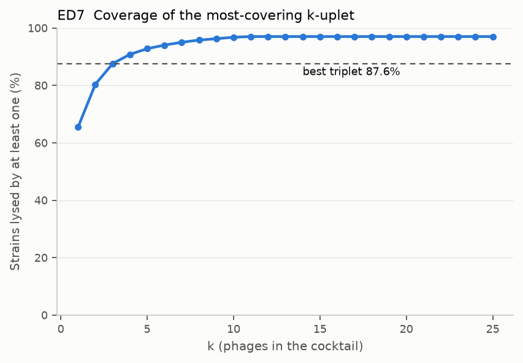

Share of strains lysed by at least one phage of the most-covering k-set (exact for k ≤ 3, greedy above), counting lysis at any concentration: 65.5 % for one phage, 80.4 % for two, 87.6 % for the triplet (536_P7, LF82_P8, NIC06_P2), 96.5 % for ten, 97.0 % for 25. The paper's Source Data gives 42.7, 57.6, 67.0, 84.1 and 89.3 % (plateau); its text says 63 % for the triplet. No choice of MLC scores reproduces the Source Data, so the definition of "productive lysis" behind it remains unknown ([05](05_paper_comparison.md)).

### ED8: the four-step recommender

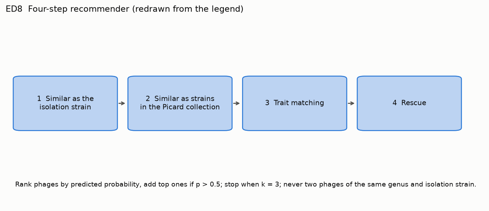

Redrawn from the legend; only the four box titles come from the figure, since the legend gives no further detail.

### ED9: generic and tailored cocktails

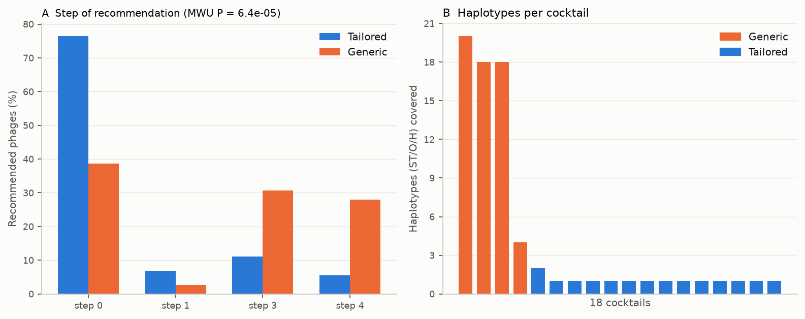

(A) Step of the pipeline at which each recommended phage was chosen. For tailored cocktails 76 % come from step 1 (similar to the isolation strain); for generic cocktails 39 % do, and 59 % come from the last two steps. Mann–Whitney P = 4e-9 (paper 3.5e-12, same direction, weaker). (B) Haplotypes (sequence type, O-type and H-type) covered by each cocktail: the four generic cocktails cover 4 to 20, the fourteen tailored ones 1 or 2.

## Schematics

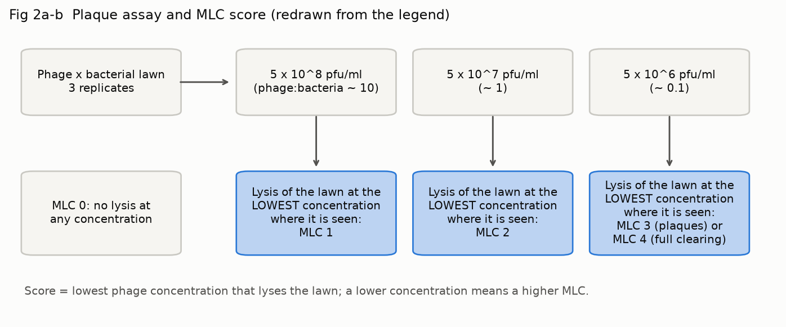

Fig 2a–b: the plaque assay at three phage concentrations and the MLC score (lowest concentration with lysis), redrawn from the legend.

## Comparison with the paper and with the shipped results

## Colour and checks

Two series use the blue `#2a78d6` and orange `#eb6834` of the reference palette; every two-series chart has a legend, no chart has two y-axes, and grid and axes are muted. The palette validator of the visualisation skill could not run on the test machine (its Node binary lacked a library), so the palette's documented, previously validated slots were used and each figure was inspected by eye.
