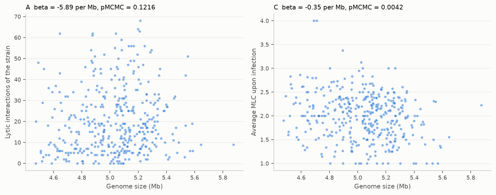

# 6. Figures

Every figure has a PNG, an SVG and a CSV with the numbers behind it, in `results/figures/` (panels of the paper) and `results/comparison/` (comparison with the paper). Scripts: `fig_main_1_2.py`, `fig1a_tree.py`, `fig_main_3_6.py`, `fig_extended.py`, `fig_schematics.py`, `fig_comparison.py` (R fits: `fig4_cd.R`, `fig_ed6.R`). The class of each panel was decided from the legends of the published article:

- **A** replicable from the shipped tables, **B** after the preprocessing steps are re-run, **C** needs inputs not shipped, **D** schematic (redrawn as a diagram).

## Coverage

| Panel | Content | Class | Status | File |
|---|---|---|---|---|
| Fig 1a | Core-genome tree with typing rings | B | drawn from our regenerated tree | `fig1a_tree` |
| Fig 1b–j | Collection descriptors (ST, O, pathotype, source, LPS, ABC, outer-membrane proteins, defense) | A | drawn | `fig1_b_j` |
| Fig 1k | Network of 1,122 phage genomes | C | not drawn: needs 1,026 GenBank genomes and vConTACT2 | – |
| Fig 2a–b | Plaque-assay and MLC schematics | D | redrawn | `schematic_fig2ab` |
| Fig 2c | Interaction matrix in tree order | A | drawn | `fig2_c` |
| Fig 2d–e | Host-range histograms | A | drawn | `fig2_d_e` |
| Fig 2f | Host range by morphotype, ANOVA | A | drawn, F = 113.9 (paper 114.7) | `fig2_f` |
| Fig 3a | Host-range UMAP, PERMANOVA | A | drawn | `fig3_a` |
| Fig 3b | Genome map of six Vectrevirus phages | C | not drawn: needs annotation and alignments | – |
| Fig 4a–b | Significant terms and hits per adsorption factor | A | drawn from our MCMC re-run | `fig4_a_d` |
| Fig 4c–d | Defense count vs infections and vs mean MLC | A | drawn with our fits | `fig4_a_d` |
| Fig 5a, c, d | Per-phage AUROC, AUROC vs lytic count, prediction matrix | A | drawn | `fig5_a_c_d` |
| Fig 5b | Pooled ROC and precision–recall | A | drawn (Phase 4) | `results/repro/fig5_curves.png` |
| Fig 6a | Experiment schematic | D | redrawn | `schematic_fig6a` |
| Fig 6b | Tree of the 100 test strains | B | not drawn: test-strain genomes are not shipped | – |
| Fig 6c–e | Cocktails, success rate, binned MLC | A | drawn | `fig6_c_e` |
| ED1 | Lab-adapted strains | A | BE and BL21 drawn; MG1655 is not in the public matrix | `ed1` |
| ED2 | Nestedness and modularity | A | drawn with NODF and our BRIM (see below) | `ed2` |
| ED3 | RBP genes as variability hotspots | C | not drawn | – |
| ED4 | RBPs and host range | B | panel A drawn from the shipped matrix | `ed4a` |
| ED5 | PDP110_P1 and Klebsiella K55 | A | drawn | `ed5` |
| ED6 | Genome size and AMR genes vs MLC | A | panels A and C drawn; B and D need an AMR annotation | `ed6_a_c` |
| ED7 | Coverage of the most-covering k-uplet | A | drawn; value differs from the paper | `ed7` |
| ED8 | Four-step recommender | D | redrawn (box titles from the legend only) | `schematic_ed8` |
| ED9 | Cocktails split into generic and tailored | A | drawn | `ed9` |

The paper uses new names for four phages; the public matrix keeps the old ones. The mapping used (AL505_P3 = AL505_Sd2, T145_P2 = 412_P2, MT1B1_P3 = MT1B1_3A1, PDP110_P1 = 411_P1) was inferred from genus and isolation strain. Only the last is confirmed: 411_P1 infects exactly three strains, all with a K55 capsule, as the paper states.

ED2 uses NODF as the nestedness measure because the BINMATNEST temperature has no implementation here, and a BRIM modularity written for this work (1,000 null matrices with the same size and connectance). The values are therefore not comparable with the paper's.

## Panels from the paper

## Schematics

## Comparison with the paper and with the shipped results

## Colour and checks

Two series use the blue `#2a78d6` and orange `#eb6834` of the reference palette; every two-series chart has a legend, no chart has two y-axes, and grid and axes are muted. The palette validator of the visualisation skill could not run on the test machine (its Node binary lacked a library), so the palette's documented, previously validated slots were used and each figure was inspected by eye.
