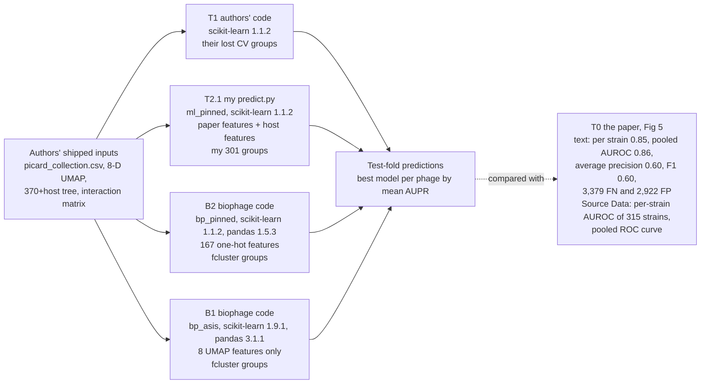
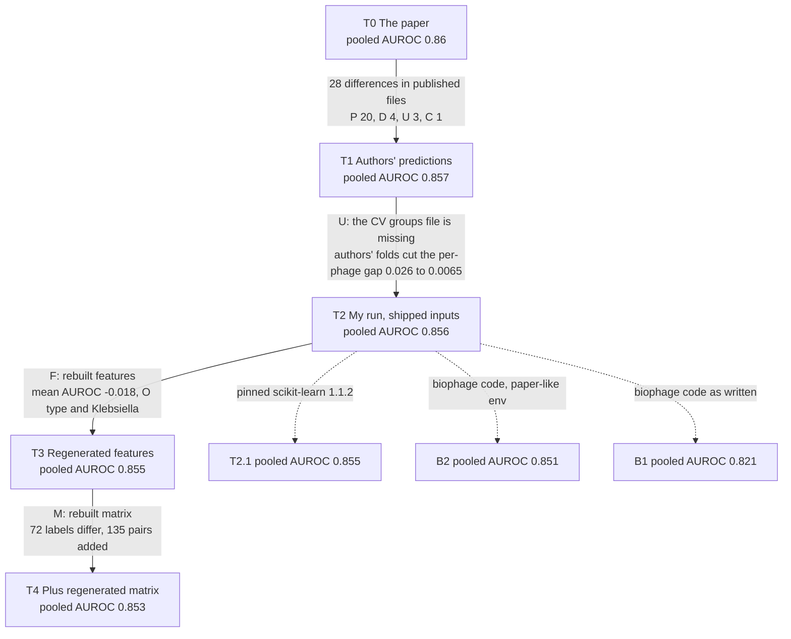
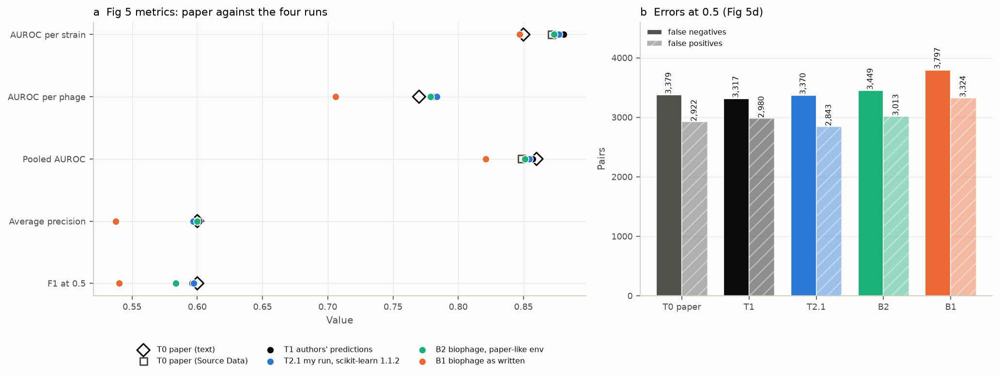
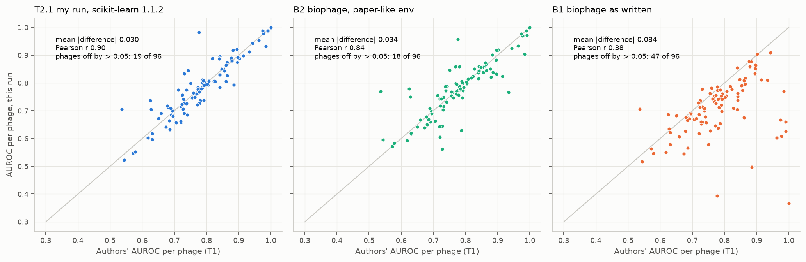
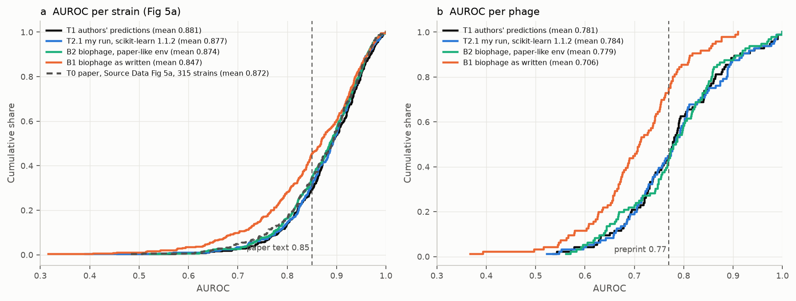
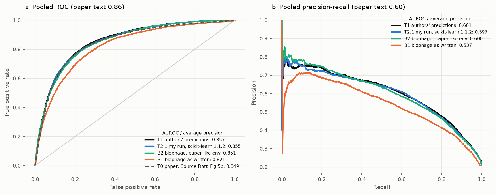
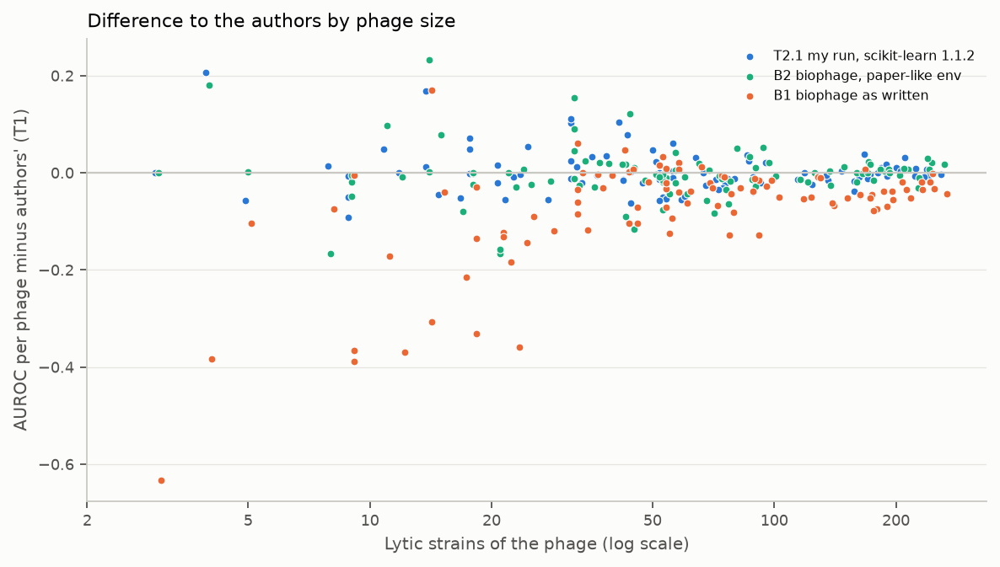

# Four model runs on the authors' inputs: the authors, mine and biophage-reproduce

This file compares the prediction results of four runs, and puts them next to the paper's own results (T0: the numbers in the published text and the Source Data of Fig 5), of the Gaborieau et al. (Nat Microbiol 2024) model. All four runs use the same inputs, the feature table, UMAP and core-genome tree the authors ship, so the differences come from the code, the software environment and the cross-validation folds. It also restates the earlier gap audit as a diagram, so the four runs can be read against the five tiers of the replication.

Date of the runs: 2026-11-11. biophage-reproduce (`biophage-reproduce-main.zip`, commit `a7dacff7`) has no licence file, so its code is not redistributed here; unzip it to `external/biophage-reproduce-main/` to rerun.

## 1. The four runs

| | T1 | T2.1 | B2 | B1 |
|---|---|---|---|---|
| What it is | the authors' own predictions, read from `dev/predictions/results/` | my `scripts/predict.py` in the pinned environment | biophage-reproduce training code, unchanged, in a paper-like environment | biophage-reproduce training code, unchanged, in its own environment |
| Code | `predict_all_phages.py` (authors) | `scripts/predict.py` | `run_training.py` + `training/` (biophage) | same as B2 |
| Environment | scikit-learn 1.1.2 (paper); rest not stated | `ml_pinned`: Python 3.10.22, scikit-learn 1.1.2, pandas 1.5.3, numpy 1.23.5, scipy 1.11.2 | `bp_pinned`: `ml_pinned` plus biopython 1.79 | `bp_asis`: `envs/training.yml` solved today: Python 3.11.18, scikit-learn 1.9.1, pandas 3.1.1, numpy 2.4.6, scipy 1.17.1, biopython 1.88 |
| Features | adsorption factors (O type, LPS, ST, Klebsiella and ABC capsule), 8-D UMAP, host-sharing features | same as T1 | every text column of the table one-hot encoded (167 columns: O type 39, H type 33, ST 30, phylogroup 14, ABC 14, UMAP 8, LPS 6, Origin 6, Host 5, Pathotype 5, Klebsiella 4, Collection 2, Gembase 1); no host-sharing features | 8 UMAP columns only (pandas 3 gives text columns the `str` dtype, and the `dtype == 'object'` test drops them all) |
| Labels | private N/P/F/U matrix | MLC score > 0, empty cells dropped | MLC score > 0, the 157 empty cells counted as negatives | same as B2 |
| CV groups | lost file `370+host_cross_validation_groups_1e-4.csv` | `connected_components(D < 1e-4)` on the shipped tree, 301 groups | `fcluster(t=1e-4)` on the shipped tree, 301 groups (same partition as mine, adjusted Rand index 1.0, different label numbers) | same as B2 |
| Folds | `GroupKFold(10)` on their groups | `GroupKFold(10)` on mine | `GroupKFold(10)` on its own labels | same, under scikit-learn 1.9.1 |
| Models and selection | 2 random forests (250 trees, depth 3 and 6), logistic regression L2 and L1, Dummy; best per phage by mean test AUPR | same | same | same |
| Seeds | `np.random.seed(0)` once; forests unseeded | random forests and Dummy `random_state=0` | none | none |
| Run time | | about 2 min | 11 min | 11 min |

How the biophage runs were set up: `scripts/biophage_inputs.py` copies its code to `replication/T93_biophage/<env>/` and fills `pipeline_results/` with the authors' `picard_collection.csv`, `coli_umap_8_dims.tsv` and `370+host_tree_orignames.nwk` (the tree leaves already carry strain names, so its LSTINFO file holds only a header). Its prediction files hold no strain names; `scripts/biophage_names.py` recovers them by repeating its deterministic `GroupKFold` split and checks that every recovered label equals the one it saved.

Diagram 1. The four runs share the inputs and the model list; they differ in code, environment, features, labels and folds, as in the table above. Their test-fold predictions are scored the way Fig 5 of the paper scores its own, and compared with the paper's numbers (T0).

## 2. Where these runs sit in the gap audit

The gap audit (report 12) follows the replication through five tiers, from the paper to a run where I rebuilt both the features and the interaction matrix. T2.1 and the two biophage runs all sit at tier T2 (shipped inputs).

Diagram 2. The five tiers of the gap audit (report 12) with the three runs of this file added as branches of T2. Cause codes on the arrows come from the gap register: P published-file difference, D documented choice, U unpublished input, C code difference, F rebuilt features, M rebuilt matrix.

## 3. Test-fold results, in the form of the paper's Fig 5

The paper reports cross-validated results: each strain is scored by a model that never saw it or any strain within 1e-4 substitutions per site. These are the "test set" results of Fig 5. The paper also scores 100 ColoColi strains as an external test set; their genomes are not deposited, so no run here can reproduce that part.

All metrics use, for each phage, the out-of-fold predictions of the best model (highest mean test AUPR). Pairs whose matrix cell is empty are left out of the scores, as in the paper; B1 and B2 trained on them as negatives. A pair is called lytic when the predicted probability is at least 0.5.

| Metric | T0 paper | T1 authors | T2.1 my run | B2 biophage, paper-like env | B1 biophage as written |
|---|---|---|---|---|---|
| Pairs scored | 38,688 | 38,377 | 38,435 | 38,435 | 38,435 |
| Pairs trained on | | 38,378 | 38,435 | 38,592 | 38,592 |
| Mean AUROC per strain (Fig 5a) | 0.85 (text); 0.872 (Source Data, 315 strains) | 0.881 | 0.877 | 0.874 | 0.847 |
| Mean AUROC per strain, on the 314 strains shared with the Source Data | 0.872 | 0.882 | 0.879 | 0.874 | 0.852 |
| Mean AUROC per phage | 0.77 (preprint) | 0.781 | 0.784 | 0.779 | 0.706 |
| Median AUROC per phage | | 0.778 | 0.781 | 0.782 | 0.711 |
| Mean AUPR per phage | | 0.586 | 0.582 | 0.570 | 0.467 |
| Pooled AUROC (Fig 5b) | 0.86 (text); 0.849 (area under the Source Data curve) | 0.857 | 0.855 | 0.851 | 0.821 |
| Pooled average precision (Fig 5b) | 0.60 | 0.601 | 0.597 | 0.600 | 0.537 |
| Precision at 0.5 | | 0.609 | 0.618 | 0.600 | 0.557 |
| Recall at 0.5 | | 0.584 | 0.577 | 0.568 | 0.524 |
| F1 at 0.5 (Fig 5d) | 0.60 | 0.596 | 0.597 | 0.584 | 0.540 |
| True positives | | 4,648 | 4,606 | 4,527 | 4,179 |
| False positives (Fig 5d) | 2,922 | 2,980 | 2,843 | 3,013 | 3,324 |
| False negatives (Fig 5d) | 3,379 | 3,317 | 3,370 | 3,449 | 3,797 |
| True negatives | | 27,432 | 27,616 | 27,446 | 27,135 |

Notes on the table:

- Paper values from the text: per strain 0.85 (Results p.2854), per phage 0.77 (preprint only), pooled AUROC 0.86 and average precision 0.60 (Fig 5b), F1 0.60 and 3,379 false negatives with 2,922 false positives over 38,688 interactions (Results).
- Paper values from the Source Data of Fig 5 (`docs/paper/supplement/MOESM9.xlsx`, sheets `Figure_5a` to `Figure_5c`): an AUROC for 315 strains (mean 0.872, median 0.892) and the points of the pooled ROC and precision-recall curves. Three things in that file do not fit the text:
  - The per-strain mean is 0.872, not 0.85. On the 314 strains it shares with my runs, the authors' own predictions give 0.882 and mine 0.879, so the Source Data sits close to the runs and the 0.85 of the text stays unexplained (it is in the gap register). Strains with no lytic phage have no AUROC, which is why the runs score about 390 strains and the Source Data 315.
  - The ROC columns are labelled the wrong way round: read as labelled, the true positive rate stays below the false positive rate along the whole curve (area 0.151). Read swapped, the area is 0.849, below the 0.86 of the text and below the authors' own shipped predictions (0.857). Figure 3 plots it swapped.
  - The precision-recall columns stop at a recall of 0.945, so the curve cannot be redrawn or its average precision recomputed; Figure 3b shows only the 0.60 of the text.
- The paper's 38,688 pairs exceed the 38,592 cells of the public 402 x 96 matrix; the authors' predictions hold 38,378. The register lists this as a published-file difference.
- Pooled AUROC on every pair B1 and B2 trained on, empty cells included as negatives: B2 0.8514, B1 0.8213. Dropping those pairs changes the third decimal only.

## 4. Per-phage agreement with the authors

| | T2.1 | B2 | B1 |
|---|---|---|---|
| Mean absolute difference in AUROC per phage against T1 | 0.030 | 0.034 | 0.084 |
| Pearson correlation of AUROC per phage with T1 | 0.90 | 0.84 | 0.38 |
| Phages off by more than 0.05 | 19 of 96 | 18 of 96 | 47 of 96 |
| Same best-model family as T1 (random forest or logistic regression) | 72.9 % | 66.7 % | 44.8 % |
| Best model: logistic regression / random forest / Dummy (T1: 59 / 37 / 0) | 55 / 41 / 0 | 67 / 29 / 0 | 18 / 77 / 1 |
| CV groups: count, and adjusted Rand index with mine | 301, 1.0 | 301, 1.0 | 301, 1.0 |
| Fold assignment, mean adjusted Rand index per phage against the authors' folds | 0.030 | 0.024 | 0.023 |
| Fold assignment against mine in the same scikit-learn version | 1.0 | 0.021 | 0.035 |

Reading the two tables together:

- B2 is as close to the authors as my own run. Its mean per-phage AUROC (0.779) and pooled AUROC (0.851) sit within 0.006 of T1 and T2.1, and its per-phage difference to T1 (0.034) is close to mine (0.030). It reaches this with a different feature set: H type, phylogroup, origin, host, pathotype and collection added, host-sharing features missing. The headline metrics do not separate the two feature sets.
- In both T2.1 and B2 most of the per-phage difference comes from the folds. Both use the same 301 groups as each other, and neither matches the authors' fold assignment (adjusted Rand index about 0.02 to 0.03), because `GroupKFold` orders equal-size groups by label number and the authors' label numbers are lost (reports 12 and 13). With the authors' folds, T2.1's per-phage difference falls to 0.0042 (report 12).
- B1 loses 0.075 of mean per-phage AUROC and most of the per-phage ranking (correlation 0.38). The cause is the environment: pandas 3.1.1 drops every text feature, so the model sees only the UMAP of the core-genome tree. Without the adsorption factors the random forests take over (77 of 96 phages).
- The biophage runs are single unseeded runs. Their random forests, Dummy and saga solver would give slightly different numbers on a rerun, so differences of about 0.005 between B2 and T2.1 are within run-to-run noise.

## 5. Figures

Figure 0. Overview against the paper. (a) The five summary metrics of Fig 5 for the paper (open diamond: published text; open square: Source Data, where it gives the value) and the four runs (dots). T1, T2.1 and B2 sit together, within 0.02 of the paper's text on pooled AUROC, average precision and F1; all three runs sit above the paper's 0.85 per strain and close to its Source Data (0.872). B1 is the only run clearly below the paper on every metric. (b) Errors at a probability threshold of 0.5 (Fig 5d): false negatives (solid) and false positives (hatched). T1, T2.1 and B2 make between 6,200 and 6,500 errors in all, as the paper does (6,301); B1 makes 7,121. Data: `results/figures/biophage_0_headline_vs_paper.csv`.

Figure 1. AUROC per phage of each run (vertical) against the authors' own predictions T1 (horizontal), one dot per phage (96). The grey diagonal marks equal values. T2.1 (blue) and B2 (green) scatter about equally around the diagonal; B1 (orange) falls below it for most phages and loses the order of the phages. Data: `results/figures/biophage_1_per_phage_vs_T1.csv`.

Figure 2. Cumulative distribution of AUROC (a) per strain, as in Fig 5a of the paper, and (b) per phage. A line further right means higher AUROC. The vertical dashed lines mark the 0.85 per strain of the paper's text and the preprint's 0.77 per phage. The grey dashed curve in (a) is the paper's own per-strain AUROC from the Source Data of Fig 5a (315 strains, mean 0.872); it runs on top of T1, T2.1 and B2, which shows that the runs reproduce the paper's distribution, while B1 sits to the left on both panels. The per-strain AUROC is computed over the pooled out-of-fold predictions of one strain against the 96 phages (strains with only one class are skipped). Data: `results/figures/biophage_2_auroc_distributions.csv`.

Figure 3. Pooled ROC (a) and precision-recall (b) curves over all scored pairs, as in Fig 5b of the paper (text: AUROC 0.86, average precision 0.60). The legend gives each run's AUROC (a) or average precision (b). The grey dashed curve in (a) is the paper's ROC curve from the Source Data of Fig 5b, read with its two columns swapped (area 0.849); it lies on the curves of T1, T2.1 and B2. B1 is lower over the whole range. The Source Data precision-recall curve is incomplete and is not drawn. Data: `results/figures/biophage_3_pooled_curves.csv` (every 20th point of the ROC curves).

Figure 4. Difference in AUROC per phage between each run and the authors (vertical) against the number of lytic strains of the phage (horizontal, log scale). For phages with fewer than about 30 lytic strains a few test strains decide the AUROC, so every run moves far from the authors there; above 50 lytic strains most T2.1 and B2 points stay within 0.05 (none beyond 0.1), while B1 stays mostly below zero. Data: `results/figures/biophage_4_difference_by_size.csv`.

## 6. Files and how to rerun

| Step | Command | Output |
|---|---|---|
| Build the two biophage environments | `micromamba create -n bp_asis ...` from `envs/training.yml` (conda-forge); `micromamba create -n bp_pinned --clone ml_pinned` then `micromamba install -n bp_pinned biopython=1.79` | `config/envs/bp_asis.yml`, `config/envs/bp_pinned.yml` (exports) |
| Run folders | `python3 scripts/biophage_inputs.py bp_asis bp_pinned` | `replication/T93_biophage/{bp_asis,bp_pinned}/` |
| Train | in each run folder: `micromamba run -n <env> python -W ignore run_training.py` | `training_results/` (per phage performances, predictions, logs, `per_phage_perf.csv`) |
| Strain names | in each run folder: `micromamba run -n <env> python ../../../scripts/biophage_names.py` | `training_results/predictions_named.csv`, `cv_groups_named.csv` |
| Comparison tables | `.venv/bin/python scripts/compare_biophage.py` | `results/audit/biophage_compare.csv`, `biophage_compare_per_phage.csv` |
| Test-fold metrics and figures | `.venv/bin/python scripts/fig_biophage.py` | `results/audit/biophage_testfold_metrics.csv`, `results/figures/biophage_{0..4}_*.{png,svg,csv}` |

The paper's per-strain values and curve points are plotted but not copied into my CSV files (only their summaries are), as for the other figures of this replication. T1 and T2.1 values come from `results/audit/pinned_env_per_phage.csv`, `pinned_env_overall.csv` and `results/audit_runs/T2_1_shipped/` (report 12). The exact packages of the two biophage environments are in `config/envs/bp_asis.yml` and `config/envs/bp_pinned.yml`.
